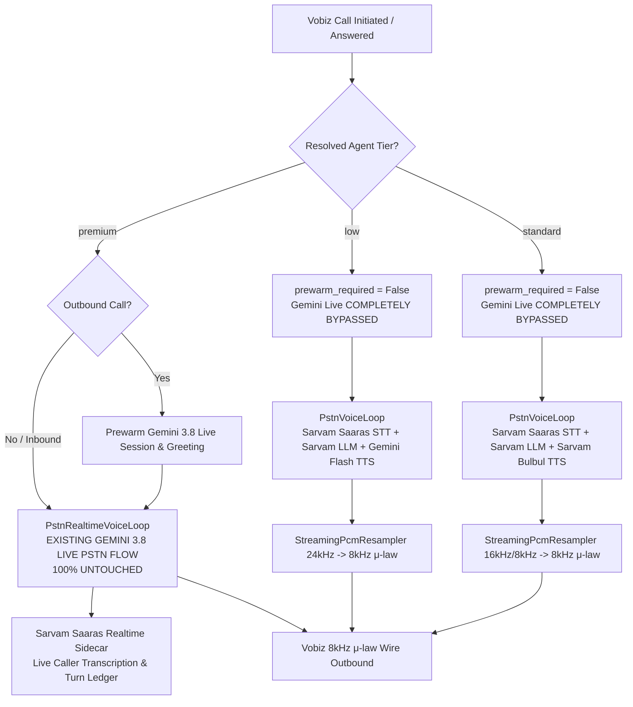
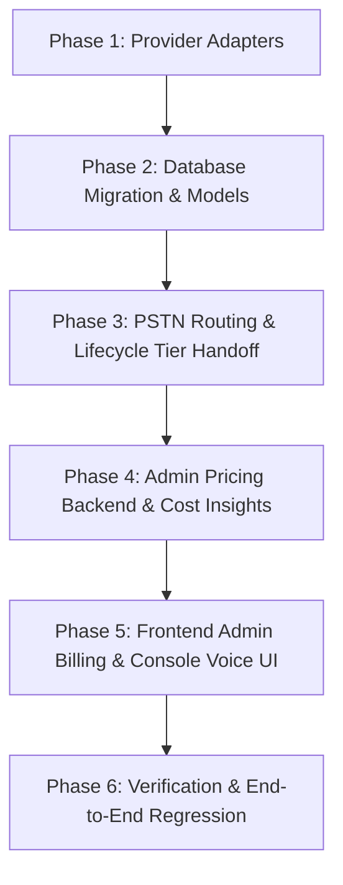

# Implementation Plan: 3-Tier Voice Stacks, Vobiz PSTN Integration & Admin Pricing Management

## 1. Executive Summary & Non-Negotiable Invariants

### 1.1 Objective
Partition the platform voice agent pipeline into **3 distinct, tenant-selectable tiers** in the console voice section, connect the non-live tiers cleanly to the Vobiz PSTN telephony flow, dynamically bill tenant wallets based on the selected tier, and upgrade the admin panel to allow platform administrators to configure selling prices and observe supplier costs/margins per stack.

```
+---------------------------------------------------------------------------------------------------+
|                                 TENANT AGENT VOICE SELECTION                                       |
+------------------------------------+--------------------------------+-----------------------------+
| Low Stack (Budget Tier)            | Standard Stack (Medium Tier)   | Premium Stack (Flagship)    |
| - STT: Sarvam Saaras Realtime      | - STT: Sarvam Saaras Realtime  | - E2E Voice: Gemini 3.8     |
| - LLM: Sarvam LLM                  | - LLM: Sarvam LLM              |   Live PSTN Flow            |
| - TTS: Gemini Flash TTS            | - TTS: Sarvam Bulbul V4 Flash  | - Transcribing Model:       |
| - Target: ₹2.50 - ₹3.50 / min      | - Target: ₹4.50 - ₹5.50 / min  |   Sarvam Saaras Realtime    |
|                                    |                                | - Target: ₹7.50 - ₹9.00/min |
+------------------------------------+--------------------------------+-----------------------------+
                                       |
                                       v
+---------------------------------------------------------------------------------------------------+
|                                   VOBIZ PSTN TELEPHONY BRIDGE                                     |
+------------------------------------+--------------------------------+-----------------------------+
| Composed Loop (PstnVoiceLoop)      | Composed Loop (PstnVoiceLoop)  | Realtime Live Loop          |
| - Vobiz WebSocket 8kHz μ-law       | - Vobiz WebSocket 8kHz μ-law   | (PstnRealtimeVoiceLoop)     |
| - STT/LLM/TTS Sentence Chunker     | - STT/LLM/TTS Sentence Chunker | - Prewarmed Socket & Audio  |
| - Real-time PCM Resampling         | - Real-time PCM Resampling     | - 100% ZERO TOUCH / AS-IS   |
| - Gemini 3.8 Live 100% BYPASSED    | - Gemini 3.8 Live 100% BYPASSED| - ONLY ACTIVE FOR PREMIUM   |
+------------------------------------+--------------------------------+-----------------------------+
                                       |
                                       v
+---------------------------------------------------------------------------------------------------+
|                                   DYNAMIC CALL BILLING & WALLET                                   |
+---------------------------------------------------------------------------------------------------+
| Call Initiation: Lock tier selling rate (applied_rate_usd_micros / applied_rate_inr_paise)        |
| Call End: Exact duration debit from tenant wallet in integer minor units (cents / paise)          |
+---------------------------------------------------------------------------------------------------+
                                       |
                                       v
+---------------------------------------------------------------------------------------------------+
|                            ADMIN PANEL PRICING & COST INSIGHTS                                    |
+---------------------------------------------------------------------------------------------------+
| Admin Rates Manager: Versioned DB configuration for Low, Standard, and Premium rates (USD & INR)  |
| Cost Insights: Live observed supplier costs (Carrier + AI Model + STT/TTS) and margins per tier   |
+---------------------------------------------------------------------------------------------------+
```

---

### 1.2 Non-Negotiable Invariants

#### 1.2.1 Absolute Core Invariant: Zero Touch on Current Gemini 3.8 Live PSTN Flow
> [!IMPORTANT]
> **THE CURRENT PRODUCTION PSTN FLOW (`new pstn flow` / GEMINI 3.8 LIVE PSTN) MUST NOT BE TOUCHED AT ALL.**
>
> 1. **Complete Code Freeze on Live Flow**:
>    - **Zero code modifications** to `server/services/pstn_realtime_voice_core.py`, `server/realtime/gemini_audio_session.py`, `server/realtime/voice_manager.py`, and the existing Vobiz stream admission handshake.
>    - All existing session reuse, fast-answer race absorption, media readiness buffering, and silent opening-delivered notes remain **100% as-is**.
> 2. **Strict Conditional Execution (Only Active for Premium Stack)**:
>    - The Gemini 3.8 Live PSTN flow must **ONLY operate when the user/tenant explicitly selects the Premium Stack** (`tier == "premium"`).
>    - If an agent is configured with the Low Stack or Standard Stack, the Gemini 3.8 Live PSTN flow is **completely bypassed, 100% dormant, and never loaded or initialized**.
> 3. **Outbound Prewarming Isolation**:
>    - In outbound call dispatch (`server/routes/dev_telephony.py`), `prewarm_required` is set to `True` **ONLY** when `tier == "premium"`.
>    - For Low and Standard stack calls, `prewarm_required = False`. The system **does not** spin up any Gemini Live sessions or synthesize prewarm greetings, preventing wasteful token usage, network allocations, or race conditions.
> 4. **No Side Effects on Existing Calls & Tests**:
>    - All existing regression tests (`test_pstn_realtime_voice.py`, `test_pstn_prewarm.py`, `test_immediate_pstn_opening.py`, `test_primary_pstn_lifecycle.py`) must pass with 100% fidelity without any mock changes or alterations to their expectations.

#### 1.2.2 Role of Sarvam Saaras Realtime in the Premium Stack (Zero Code Changes to Live Core)
- In the **Premium Stack**, Gemini 3.8 Live handles the end-to-end conversational audio (listening to caller PCM and synthesizing agent voice directly).
- **Sarvam Saaras Realtime (`saaras:v3-realtime`)** is strictly the **Transcribing Model**: it runs in parallel as a sidecar on caller audio to feed high-fidelity Indic text into the live console transcript, turn ledger, and post-call compliance analytics.
- **Architectural Discovery & Zero-Touch Guarantee**:
  - `server/services/live_caller_transcription.py` already includes `LiveCallerTranscriber` with full `saaras:v3-realtime` WebSocket streaming support.
  - `server/services/pstn_realtime_voice_core.py` already invokes `_start_caller_stt_sidecar()` driven by `transcription_policy`.
  - When the Premium Stack specifies `transcription: {"live_enabled": true, "live_model": "saaras:v3-realtime"}`, `PstnRealtimeVoiceLoop` automatically starts the Sarvam Saaras sidecar **without requiring a single line of code modification in `pstn_realtime_voice_core.py`**.

#### 1.2.3 Strict Vendor & Secret Scrubbing in Tenant Surface
- Tenant-facing frontends (`voxly-ai`, Next.js console) and subscriber APIs (`/api/telephony/*`, `/api/integrations/*`) must **NEVER** expose wholesale provider names (`sarvam`, `gemini`, `vobiz`, `telnyx`), internal endpoints, Auth IDs, or secret keys.
- Tiers are presented with clean, customer-centric designations:
  - Low Stack $\rightarrow$ **"Economical Tier"** / **"Budget Natural Voice"**
  - Standard Stack $\rightarrow$ **"Standard Tier"** / **"Expressive Regional Voice"**
  - Premium Stack $\rightarrow$ **"Flagship Tier"** / **"Ultra-Realistic Live Conversational AI"**

#### 1.2.4 Database Configuration Persistence Across Server Restarts
- Never wipe or reset tier assignments or rate configurations during startup.
- All configurations persist in PostgreSQL (`tier_assignments`, `config_versions`, `billing_rate_versions`, `agents.default_tier`) and hydrate cleanly on server lifespan boot.

#### 1.2.5 Financial Safety & Minor-Unit Math
- All rate calculations and wallet adjustments execute inside transactions with row locking (`with_for_update`), using integer minor units (USD microdollars and INR paise), with unique idempotency keys (`call:{call_id}`).

---

## 2. Stack Topology & Component Matrix

| Component | Low Stack (Budget Tier) | Standard Stack (Medium Tier) | Premium Stack (Flagship Tier) |
| :--- | :--- | :--- | :--- |
| **Canonical Tier Key** | `low` | `standard` | `premium` |
| **Accepted Aliases** | `budget` | `medium` | `flagship`, `high` |
| **Customer Display Name** | **Economical Tier** | **Standard Regional Tier** | **Flagship Live Tier** |
| **Telephony Engine** | Composed Loop (`PstnVoiceLoop`) | Composed Loop (`PstnVoiceLoop`) | **Gemini 3.8 Live Loop (`PstnRealtimeVoiceLoop`)** |
| **Condition to Activate** | Tenant selects "Economical" | Tenant selects "Standard" | **Tenant selects "Flagship / Premium"** |
| **Gemini 3.8 Live State** | **100% Bypassed & Dormant** | **100% Bypassed & Dormant** | **Active (Existing Flow - Untouched)** |
| **Prewarming Behavior** | `prewarm_required = False` (No Live session) | `prewarm_required = False` (No Live session) | `prewarm_required = True` (Gemini Live session prewarmed) |
| **Speech-to-Text (STT)** | Sarvam Saaras Realtime (`saaras:v3-realtime`) | Sarvam Saaras Realtime (`saaras:v3-realtime`) | Gemini Live Audio Ingest |
| **Brain / LLM** | Sarvam LLM (`sarvam-m` / `sarvam-2b`) | Sarvam LLM (`sarvam-m` / `sarvam-2b`) | Gemini 3.8 Live Conversational Core |
| **Text-to-Speech (TTS)** | Gemini Flash TTS (`gemini-2.5-flash-preview-tts`) | Sarvam TTS Bulbul V4 Flash (`bulbul:v4-flash` / `bulbul:v3`) | Gemini 3.8 Live Native Speech Synthesis |
| **Transcribing Model** | Built into pipeline loop via Sarvam STT | Built into pipeline loop via Sarvam STT | **Sarvam Saaras Realtime (`saaras:v3-realtime`)** sidecar ASR for ledger |
| **Audio Transcode** | 24kHz PCM16 $\rightarrow$ 8kHz μ-law wire | 16kHz/8kHz PCM16 $\rightarrow$ 8kHz μ-law wire | Native 16kHz/24kHz $\rightarrow$ 8kHz μ-law wire |
| **Observed Supplier Cost** | $\approx$ **₹1.35 / min** ($0.014/min)<br>• STT: ₹0.15/min<br>• LLM: ₹0.12/min<br>• TTS: ₹0.50/min (₹0.34/1k chars)<br>• Vobiz: ₹0.58/min | $\approx$ **₹2.05 / min** ($0.021/min)<br>• STT: ₹0.15/min<br>• LLM: ₹0.12/min<br>• TTS: ₹1.20/min<br>• Vobiz: ₹0.58/min | $\approx$ **₹2.85 / min** ($0.030/min)<br>• Live E2E: ₹1.80/min<br>• Sarvam ASR: ₹0.15/min<br>• Vobiz: ₹0.58/min<br>• Prewarm overhead: ₹0.32/min |
| **Suggested Admin Selling Price** | **₹2.90 - ₹3.50 / min** ($0.035 - $0.040/min) | **₹4.90 - ₹5.50 / min** ($0.055 - $0.060/min) | **₹7.90 - ₹9.00 / min** ($0.085 - $0.095/min) |
| **Tenant Voice Roster** | Gemini Flash Voices (`Aoede`, `Puck`, `Kore`, `Leda`, `Charon`, `Fenrir`) | Sarvam Bulbul Voices (`shubh`, `priya`, `neha`, `rahul`, `pooja`, `kavitha`, `rohan`) | Curated Indic Gemini Live Voices (`te-in-csagent-5`, `te-in-csagent-1`, `te-in-concierge-2`, etc.) |

---

## 3. Telephony Routing & Vobiz PSTN Integration



### 3.1 Dual-Loop Factory Dispatch Invariant
In `server/services/pstn_voice_flow.py` and `server/services/vobiz_pstn_bridge.py`:

```python
# server/services/pstn_voice_flow.py

def is_realtime_e2e_stack(stack_override: dict[str, Any] | None) -> bool:
    """Return True ONLY if the stack explicitly opted into speech-to-speech E2E (Premium)."""
    return uses_realtime_voice(stack_override=stack_override)

def create_pstn_voice_loop(*, stack_override: dict[str, Any] | None = None, **kwargs: Any) -> Any:
    """
    CRITICAL DISPATCH INVARIANT:
    - If Premium stack (realtime_voice): Return existing, untouched PstnRealtimeVoiceLoop.
    - If Low or Standard stack: Return composed PstnVoiceLoop.
    """
    if is_realtime_e2e_stack(stack_override):
        from server.services.pstn_realtime_voice_core import PstnRealtimeVoiceLoop
        kwargs["stack_override"] = stack_override
        return PstnRealtimeVoiceLoop(**kwargs)
    return PstnVoiceLoop(**kwargs)
```

### 3.2 Dispatch Behavior by Tier
1. **Premium Stack (`tier == "premium"`)**:
   - `is_realtime_e2e_stack()` returns `True`.
   - Dispatches to `PstnRealtimeVoiceLoop`.
   - **Zero code modifications** to `pstn_realtime_voice_core.py`. Prewarm session handoff, audio cache consumption, and silent opening-delivered notes execute as currently designed.
   - Sarvam Saaras Realtime runs in parallel as the transcribing engine for the call ledger via `LiveCallerTranscriber`.
2. **Low & Standard Stacks (`tier in ("low", "standard")`)**:
   - `is_realtime_e2e_stack()` returns `False`.
   - Dispatches to `PstnVoiceLoop` (the composed STT $\rightarrow$ LLM $\rightarrow$ TTS pipeline).
   - In `VobizPstnBridge`:
     - Inbound audio frames from Vobiz:
       ```python
       pcm16 = mulaw_to_pcm16(payload)
       await self._voice.feed_user_pcm16(pcm16)
       ```
     - Outbound synthesized audio from agent:
       ```python
       async def _send_agent_wire(wire: bytes) -> None:
           await self.send_media_frame(wire)
       ```
     - `PstnVoiceLoop` handles barge-in detection, speech-end debounce, sentence chunking, and full conversational state transitions without touching the Gemini Live loop.

### 3.3 Outbound Dial Prewarm Isolation Logic (`server/routes/dev_telephony.py`)
When an outbound call is dialed:
```python
is_premium_call = (
    str(tier or "").lower() in ("premium", "flagship", "high")
    or (str(live_llm.get("provider") or "").lower() == "gemini" and is_gemini_live_voice_model(str(live_llm.get("model") or "")))
)

prewarm_required = is_premium_call

if is_premium_call:
    await pstn_prewarm_registry.prepare("vobiz", tracking_id, {...})
else:
    # For Low and Standard stacks, skip Gemini Live prewarming completely.
    log_pstn("outbound.prewarm.skipped_non_premium", control=tracking_id, tier=tier)
```

---

## 4. Backend Provider Implementations

To enable the Low and Standard stacks, two provider adapters are integrated in `server/providers/`:

### 4.1 `SarvamLLMAdapter` (`server/providers/sarvam_llm.py`)
Sarvam provides OpenAI-compatible REST endpoints at `https://api.sarvam.ai/v1/chat/completions` supporting `sarvam-m`, `sarvam-2b`, and `sarvam-105b-conversations` with low latency streaming.

- **Class Definition**:
  ```python
  class SarvamLLMAdapter(LLMAdapter):
      provider_id = "sarvam"

      async def stream_live_turn(
          self,
          *,
          input_messages: list[dict[str, Any]],
          model: str = "sarvam-m",
          temperature: float = 0.3,
          max_output_tokens: int = 150,
          **kwargs: Any,
      ) -> AsyncIterator[dict[str, Any]]:
          ...
  ```
- **Features**:
  - Implements Server-Sent Events (SSE) streaming (`stream: True`) to yield incremental text tokens with sub-400ms Time-to-First-Token (TTFT).
  - Handles system instructions, Indic language enforcement, and end-of-call detection payloads.
  - Automatically handles prompt caching and token accounting for billing audits.

### 4.2 `GeminiTTSAdapter` (`server/providers/gemini_tts.py`)
Gemini 2.5/3.1 Flash TTS generates natural Indic audio via Google AI Studio (`generativelanguage.googleapis.com`) using `responseModalities: ["AUDIO"]`.

- **Class Definition**:
  ```python
  class GeminiTTSAdapter(TTSAdapter):
      provider_id = "gemini"

      def connect_stream(self, config: TTSConfig):
          # Returns an async streaming session compatible with PstnTurnTtsSession
          return GeminiStreamingTtsSession(config=config)

      async def synthesize_rest(self, text: str, config: TTSConfig) -> bytes:
          ...
  ```
- **Streaming Audio Pipeline**:
  - `GeminiStreamingTtsSession` accepts text chunks from `PstnVoiceLoop`.
  - Calls `models/gemini-2.5-flash-preview-tts:generateContent` (or `streamGenerateContent`).
  - Streams 24kHz PCM16 audio blocks down to `PstnTurnTtsSession` in base64 chunks (`{"type": "chunk", "data": {"audio": "..."}}`).
  - `PstnTurnTtsSession`'s resampler converts 24kHz PCM16 into 8kHz μ-law frames (`_MULAW_FRAME_BYTES = 160`) for smooth transmission over Vobiz telephony.

### 4.3 Provider Registry Registration (`server/providers/registry.py`)
Register the adapters in `ProviderRegistry._build()`:
```python
# server/providers/registry.py
if enable_sarvam:
    from server.providers.sarvam_llm import SarvamLLMAdapter
    self._stt["sarvam"] = SarvamSTTAdapter()
    self._tts["sarvam"] = SarvamTTSAdapter()
    self._llm["sarvam"] = SarvamLLMAdapter()

if enable_gemini:
    from server.providers.gemini_tts import GeminiTTSAdapter
    self._tts["gemini"] = GeminiTTSAdapter()
```

### 4.4 Stack Resolver Default Stacks (`server/providers/resolver.py`)
Configure the default tier combinations in `server/providers/resolver.py`:
- `low`:
  - `stt`: `provider: "sarvam"`, `model: "saaras:v3-realtime"`
  - `llm`: `provider: "sarvam"`, `model: "sarvam-m"`
  - `tts`: `provider: "gemini"`, `model: "gemini-2.5-flash-preview-tts"`
- `standard` (aliased to `medium`):
  - `stt`: `provider: "sarvam"`, `model: "saaras:v3-realtime"`
  - `llm`: `provider: "sarvam"`, `model: "sarvam-m"`
  - `tts`: `provider: "sarvam"`, `model: "bulbul:v4-flash"`
- `premium`:
  - `stt`: `provider: "sarvam"`, `model: "saaras:v3-realtime"` (transcribing sidecar)
  - `llm`: `provider: "gemini"`, `model: "gemini-3.8-live"`
  - `tts`: `provider: "gemini"`, `model: "gemini-3.8-live"`
  - `pipeline`: `"realtime_voice"`

---

## 5. Database Schema, Agent Persistence & Migration

### 5.1 Agent Model Persistence (`server/db/models/entities.py`)
In PostgreSQL, agents store their default tier in `Agent.default_tier`:
```python
class Agent(Base):
    __tablename__ = "agents"

    # ... existing fields ...
    default_tier: Mapped[str] = mapped_column(String(20), default="medium")
    voice_settings: Mapped[dict] = mapped_column(JSONB, default=dict)
```

**Normalization Rule**:
When updating an agent (`PATCH /api/agents/{id}` or `PUT /api/agents/{id}`):
- `"low"` / `"budget"` $\rightarrow$ saved to `default_tier = "low"`
- `"standard"` / `"medium"` $\rightarrow$ saved to `default_tier = "standard"`
- `"premium"` / `"flagship"` $\rightarrow$ saved to `default_tier = "premium"`
- Sync `voice_settings["tier"] = normalized_tier` to ensure frontend backward-compatibility.

### 5.2 Alembic Migration: `042_add_per_tier_billing_rates.py`
Extend `billing_rate_versions` to persist administrator selling prices for all 3 stacks:

```python
"""Add per-tier billing rates for low, standard, and premium voice stacks.

Revision ID: 042_per_tier_rates
Revises: 041_...
"""
from alembic import op
import sqlalchemy as sa

def upgrade():
    # Minor unit columns: USD in microdollars ($1.00 = 1,000,000), INR in paise (₹1.00 = 100)
    op.add_column("billing_rate_versions", sa.Column("pstn_low_usd_micros_per_min", sa.BigInteger(), nullable=True))
    op.add_column("billing_rate_versions", sa.Column("pstn_low_inr_paise_per_min", sa.BigInteger(), nullable=True))
    op.add_column("billing_rate_versions", sa.Column("pstn_standard_usd_micros_per_min", sa.BigInteger(), nullable=True))
    op.add_column("billing_rate_versions", sa.Column("pstn_standard_inr_paise_per_min", sa.BigInteger(), nullable=True))
    op.add_column("billing_rate_versions", sa.Column("pstn_premium_usd_micros_per_min", sa.BigInteger(), nullable=True))
    op.add_column("billing_rate_versions", sa.Column("pstn_premium_inr_paise_per_min", sa.BigInteger(), nullable=True))

    # Seed initial tier rates based on existing pstn_rate columns
    op.execute("""
        UPDATE billing_rate_versions
        SET
            pstn_low_usd_micros_per_min = COALESCE(pstn_rate_usd_micros_per_min / 2, 45000),
            pstn_low_inr_paise_per_min = COALESCE(pstn_rate_inr_paise_per_min / 2, 350),
            pstn_standard_usd_micros_per_min = COALESCE(pstn_rate_usd_micros_per_min, 70000),
            pstn_standard_inr_paise_per_min = COALESCE(pstn_rate_inr_paise_per_min, 550),
            pstn_premium_usd_micros_per_min = COALESCE(pstn_rate_usd_micros_per_min * 13 / 10, 95000),
            pstn_premium_inr_paise_per_min = COALESCE(pstn_rate_inr_paise_per_min * 13 / 10, 800)
    """)

def downgrade():
    op.drop_column("billing_rate_versions", "pstn_premium_inr_paise_per_min")
    op.drop_column("billing_rate_versions", "pstn_premium_usd_micros_per_min")
    op.drop_column("billing_rate_versions", "pstn_standard_inr_paise_per_min")
    op.drop_column("billing_rate_versions", "pstn_standard_usd_micros_per_min")
    op.drop_column("billing_rate_versions", "pstn_low_inr_paise_per_min")
    op.drop_column("billing_rate_versions", "pstn_low_usd_micros_per_min")
```

### 5.3 Updated SQLAlchemy Models (`server/db/models/saas_models.py`)
```python
class BillingRateVersion(Base):
    __tablename__ = "billing_rate_versions"

    # Existing columns ...
    pstn_rate_usd_micros_per_min: Mapped[int | None] = mapped_column(BigInteger, nullable=True)
    pstn_rate_inr_paise_per_min: Mapped[int | None] = mapped_column(BigInteger, nullable=True)

    # Per-tier Selling Rates
    pstn_low_usd_micros_per_min: Mapped[int | None] = mapped_column(BigInteger, nullable=True)
    pstn_low_inr_paise_per_min: Mapped[int | None] = mapped_column(BigInteger, nullable=True)
    pstn_standard_usd_micros_per_min: Mapped[int | None] = mapped_column(BigInteger, nullable=True)
    pstn_standard_inr_paise_per_min: Mapped[int | None] = mapped_column(BigInteger, nullable=True)
    pstn_premium_usd_micros_per_min: Mapped[int | None] = mapped_column(BigInteger, nullable=True)
    pstn_premium_inr_paise_per_min: Mapped[int | None] = mapped_column(BigInteger, nullable=True)
```

---

## 6. Dynamic Tier Costing & Wallet Deductions

### 6.1 Call Rate Snapshotting (`server/call/call_lifecycle_service.py`)
When a call is initiated, the platform resolves the tier associated with the agent or campaign and snapshots the exact per-minute rates into the call record:

```python
# server/call/call_lifecycle_service.py

raw_tier = (stack.tier or effective_tier or getattr(agent, "default_tier", None) or "standard").lower()
if raw_tier in ("low", "budget"):
    call_tier = "low"
    snap_micros = cur_rates.get("pstn_low_usd_micros_per_min") or (cur_rates["pstn_rate_usd_micros_per_min"] // 2)
    snap_paise = cur_rates.get("pstn_low_inr_paise_per_min") or (cur_rates["pstn_rate_inr_paise_per_min"] // 2)
elif raw_tier in ("premium", "flagship", "high"):
    call_tier = "premium"
    snap_micros = cur_rates.get("pstn_premium_usd_micros_per_min") or int(cur_rates["pstn_rate_usd_micros_per_min"] * 1.3)
    snap_paise = cur_rates.get("pstn_premium_inr_paise_per_min") or int(cur_rates["pstn_rate_inr_paise_per_min"] * 1.3)
else:
    call_tier = "standard"
    snap_micros = cur_rates.get("pstn_standard_usd_micros_per_min") or cur_rates["pstn_rate_usd_micros_per_min"]
    snap_paise = cur_rates.get("pstn_standard_inr_paise_per_min") or cur_rates["pstn_rate_inr_paise_per_min"]

record["applied_tier"] = call_tier
record["applied_rate_usd_micros_per_min"] = snap_micros
record["applied_rate_inr_paise_per_min"] = snap_paise
record["applied_fx_rate_inr"] = float(cur_rates.get("fx_rate_inr") or 95.64)
record["rate_version"] = int(cur_rates.get("version") or 1)
```

### 6.2 Wallet Debit Execution (`server/services/saas/billing_wallet_service.py`)
When the call ends:
1. Duration is rounded up to the nearest billable second.
2. `_resolve_call_wallet_debit` calculates:
   $$\text{USD cents} = \max\left(1, \left\lceil \frac{\text{duration\_sec} \times \text{snap\_micros}}{600,000} \right\rceil\right)$$
   $$\text{INR paise} = \max\left(1, \left\lceil \frac{\text{duration\_sec} \times \text{snap\_paise}}{60} \right\rceil\right)$$
3. Performs atomic balance debit with `with_for_update` row-locking on `tenant_wallets`.

---

## 7. Admin Panel Configuration & Cost Insights

### 7.1 Backend API Updates (`server/routes/dev_admin.py` & `server/services/saas/billing_rates.py`)
- **`GET /api/dev/admin/billing-rates`**:
  Returns current rates broken down by stack:
  ```json
  {
    "currency": "USD",
    "rates": {
      "pstnLowUsdPerMin": 0.035,
      "pstnLowInrPerMin": 3.00,
      "pstnStandardUsdPerMin": 0.055,
      "pstnStandardInrPerMin": 5.00,
      "pstnPremiumUsdPerMin": 0.085,
      "pstnPremiumInrPerMin": 8.00,
      "webUsdPerMin": 0.040,
      "webInrPerMin": 3.50,
      "numberMonthlyUsd": 2.50,
      "numberMonthlyInr": 200.00,
      "fxRateInr": 95.64
    },
    "fx": { "chargeRateInr": 95.64, "liveRateInr": 95.64 }
  }
  ```
- **`PUT /api/dev/admin/billing-rates`**:
  Accepts updates with an audit reason statement, validating that all rates $> 0$.
- **`GET /api/dev/admin/billing/cost-insights`**:
  Updates `server/services/saas/cost_insights.py` to aggregate supplier spend across all 3 tiers:
  - Reports carrier charges (Vobiz per minute).
  - Reports AI model inference costs (Sarvam LLM vs Gemini Live).
  - Reports speech synthesis costs (Gemini Flash TTS vs Sarvam Bulbul).
  - Reports transcription costs (Sarvam Saaras Realtime).
  - Calculates observed margin % for each tier against admin selling rates.

### 7.2 Frontend Admin UI Updates (`web/app/dev/(portal)/admin/billing/page.tsx` & `CostInsightsPanel.tsx`)
1. **Tier Pricing Grid**:
   Replace the single PSTN input with a structured 3-card stack pricing component:
   - **Low Stack (Budget)**: Inputs for USD/min and INR/min.
   - **Standard Stack (Medium)**: Inputs for USD/min and INR/min.
   - **Premium Stack (Flagship)**: Inputs for USD/min and INR/min.
2. **Observed Cost & Margin Table**:
   `CostInsightsPanel.tsx` displays real-time supplier costs vs selling rates:
   | Stack | Telephony (Vobiz) | LLM Engine | TTS / Voice | STT ASR | Total Supplier Cost | Admin Selling Price | Gross Margin |
   | :--- | :--- | :--- | :--- | :--- | :--- | :--- | :--- |
   | **Low** | ₹0.58/min | ₹0.12/min | ₹0.50/min | ₹0.15/min | **₹1.35/min** | **₹3.00/min** | **+55.0%** |
   | **Standard** | ₹0.58/min | ₹0.12/min | ₹1.20/min | ₹0.15/min | **₹2.05/min** | **₹5.00/min** | **+59.0%** |
   | **Premium** | ₹0.58/min | ₹1.80/min | Incl. (Live) | ₹0.15/min | **₹2.85/min** | **₹8.00/min** | **+64.4%** |

---

## 8. Tenant Console Voice Section UI & Audio Samples

### 8.1 Tenant UI Component (`AgentVoicePanel.jsx`)
In `voxly-ai/src/console/modules/agent-workspace/AgentVoicePanel.jsx`:
- Introduce a high-density **Voice Stack Selector** tabs at the top of the voice roster:
  - `[ Economical Stack ]` · Budget Indic TTS & Low Latency
  - `[ Standard Stack ]` · Natural Regional Voices (Bulbul)
  - `[ Flagship Live ]` · Ultra-Realistic Sub-500ms Conversational E2E
- Selecting a stack filters the visible voice roster and plays only the audio samples generated for that tier.

### 8.2 Sample Audio Matrix (Categorized by Tier)
Pre-rendered sample files stored in `samples/direct_model_comparison/` and served via `/audio/voxly/samples/`:
- **Low Stack Voice Samples**:
  - `gemini_flash_tts_telugu.wav`
  - `gemini_flash_tts_hindi.wav`
  - Additional voices: Puck, Aoede, Kore, Leda, Charon, Fenrir
- **Standard Stack Voice Samples**:
  - `sarvam_bulbul_telugu.wav`
  - `sarvam_bulbul_hindi.wav`
  - Additional voices: Shubh, Priya, Neha, Rahul, Pooja, Kavitha
- **Premium Stack Voice Samples**:
  - `te-in-csagent-5` (Native Telugu Support Female)
  - `te-in-csagent-1` (Native Telugu Support Low-Pitch)
  - `te-in-concierge-2` (Telugu Concierge Male)
  - `hi-in-csagent-1` (Haryanvi Hindi Female)
  - `ta-in-csagent-3` (Native Tamil Support Female)

---

## 9. Step-by-Step Implementation Roadmap



### Phase 1: Provider Adapters & Registry
1. Create `server/providers/sarvam_llm.py` implementing `SarvamLLMAdapter`.
2. Create `server/providers/gemini_tts.py` implementing `GeminiTTSAdapter` with streaming audio frame conversion.
3. Update `server/providers/registry.py` to register both adapters.
4. Update `server/providers/resolver.py` with default tier stack definitions.

### Phase 2: Database Migration & Models
1. Create Alembic migration `042_add_per_tier_billing_rates.py`.
2. Update `BillingRateVersion` in `server/db/models/saas_models.py`.
3. Update `server/services/saas/billing_rates.py` with expanded tier fields, loaders, and persistence logic.
4. Verify `Agent.default_tier` mapping for `"low"`, `"standard"`, `"premium"`.

### Phase 3: Telephony Routing & Lifecycle Tier Handoff
1. Update `server/call/call_lifecycle_service.py` to resolve and snapshot tier-specific rates into call records.
2. In `server/routes/dev_telephony.py`, guard outbound prewarming: `prewarm_required = True` ONLY when `tier == "premium"`.
3. Verify `server/services/vobiz_pstn_bridge.py` and `server/services/pstn_voice_flow.py` cleanly route:
   - **Premium Stack** $\rightarrow$ `PstnRealtimeVoiceLoop` (**100% UNTOUCHED**).
   - **Low & Standard Stacks** $\rightarrow$ `PstnVoiceLoop` (composed STT $\rightarrow$ LLM $\rightarrow$ TTS).
4. Connect `GeminiTTSAdapter` and `SarvamTTSAdapter` output audio frames into the Vobiz 8kHz μ-law streaming pipeline.

### Phase 4: Admin Billing Backend & Cost Insights
1. Update `GET /api/dev/admin/billing-rates` and `PUT /api/dev/admin/billing-rates` in `server/routes/dev_admin.py`.
2. Update `server/services/saas/cost_insights.py` to calculate observed supplier costs and margins per tier.

### Phase 5: Frontend Updates (Admin & Tenant Console)
1. In `web/app/dev/(portal)/admin/billing/page.tsx`, update pricing inputs to support Low, Standard, and Premium rates.
2. In `web/components/admin/CostInsightsPanel.tsx`, display supplier costs and margins for all 3 stacks.
3. In `voxly-ai/src/console/modules/agent-workspace/AgentVoicePanel.jsx`, implement the 3-tier voice stack selector and categorized voice roster.

### Phase 6: Verification & Testing
1. **SAST Security Audit**:
   `python scripts/security_audit.py --mode sast` (0 blocking findings).
2. **Acceptance Tests**:
   - `test_pstn_prewarm.py` & `test_pstn_realtime_voice.py`: Verify Gemini 3.8 Live PSTN flow has 0 regressions.
   - `test_pstn_voice_core.py`: Verify composed Vobiz flow for Low and Standard stacks.
   - `test_billing_rates_persistence.py`: Verify per-tier rate updates, database versioning, and wallet debits.
3. **Reticle UI Verification**:
   Drive the Voice & Language Studio in `voxly-ai` and verify tab switching, sample audio playback, and stack selection persistence.
