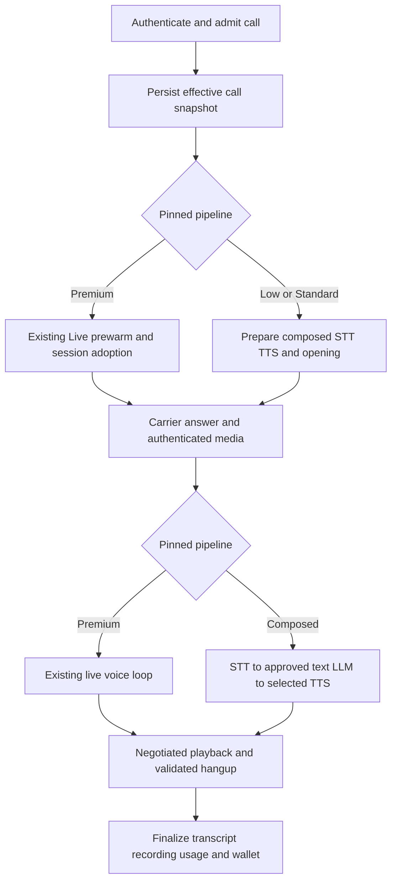

# Implementation Plan: Three Voice Stacks with Admin-Controlled TTS

Status: implementation specification; new stacks are not declared implemented or released.
Reviewed: 2026-10-22. Recorded Premium baseline: commit `514e8f8`.
This document update clarifies the plan. It does not execute application changes, migrations, pricing changes, or production enablement.

## 1. Purpose and instructions for implementing agents

Add Economical and Standard composed voice stacks around the existing Premium Gemini Live 3.8 PSTN flow. Both new stacks support an administrator-approved choice of Sarvam Bulbul or Gemini TTS. Tenants may choose only options the platform admin has enabled. Keep the existing compiled script, tenant tools, admission, wallet, and recording workflows connected to the selected stack.

Read this specification as follows:

- **Current** means verified in the repository during this review, not verified in production.
- **Required** describes the intended implementation and acceptance criteria.
- **Proposed** identifies an additive API/schema change requiring review before implementation.
- **Release blocker** keeps an affected new profile disabled until the stated evidence or decision exists.
- Paths and symbols are navigation references. Re-read current definitions before editing; concurrent uncommitted work may have changed them.

The former sample adapters, migration, rates, and voice descriptions mixed assumptions with implementation facts. This document replaces them with explicit contracts and release gates.

### 1.1 Current verified baseline

| Area | Current repository behavior | Consequence |
| --- | --- | --- |
| Primary supported PSTN baseline | Premium Gemini Live 3.8 over the new Vobiz flow | Preserve this baseline before enabling additional stacks. Secondary OpenAI/Telnyx paths are outside this feature's scope. |
| Tier identifiers | `constants.TIER_NAMES` is `low`, `medium`, `premium`; agents commonly default to `medium` | Use `medium` internally for customer-facing Standard. A legacy tier does not prove which pipeline actually runs. |
| SaaS resolution | `saas_stack_override_for_agent()` resolves the universal stack, then applies agent voice/language settings | It does not currently implement the three-stack routing specified here. |
| Loop factory | `create_pstn_voice_loop()` selects through pipeline capabilities/`uses_realtime_voice()` | A tier label alone does not select a loop. Resolve and validate a complete stack first. |
| Composed normalization | The non-live normalization path rewrites pipeline settings and removes the LLM override | Adding `llm.provider="sarvam"` to JSON alone will not make composed calls use Sarvam. |
| Provider registry | Sarvam STT/TTS adapters exist; Sarvam LLM and Gemini TTS are not registered as composed stages | Extend existing Sarvam TTS; add missing stages without duplicating adapters. |
| Agent persistence | The agent PATCH endpoint accepts voice settings; `agent_service.patch_agent()` merges their JSON | Validate merged effective settings, including partial updates and stale voice IDs. |
| Billing | Versioned PSTN/web rates, call snapshots, native INR/USD values, wallet settlement, and cost insights exist | Extend these owners; do not build a second billing engine. |
| Media | `VobizPstnBridge` negotiates codec/sample rate, including PCM16 and G.711 paths | Do not assume every call uses 8 kHz mu-law. |

Source references are in section 18. Uncommitted speech-gate, catalog, and preview changes are work in progress, not proof that a release has passed.

### 1.2 Preserve the Premium baseline

Required constraints for stack expansion:

1. Preserve the existing live session, greeting/session reuse, media-readiness buffering, greeting protection, interruption handling, and validated hangup behavior.
2. Do not rewrite `pstn_realtime_voice_core.py`, `gemini_audio_session.py`, or `voice_manager.py` to implement composed stages. Add composed behavior through its own resolved path.
3. Shared admission, factory, catalog, billing, or bridge changes require necessity and Premium regression coverage.
4. Separately authorized Premium bug fixes, including the speech-interruption work discussed before this plan update, are a separate change set. Review their resulting baseline first; do not freeze known defects or silently combine them with stack expansion.
5. Low/Standard calls must not create Gemini **Live** sessions. Gemini **TTS** use in these calls is permitted and is a separate API/billing category.
6. Assert network requests, live-session allocation, usage, and routing. Module import itself is not the protected boundary.

## 2. Product definition and canonical names

| Product label | Persisted tier | Conversation pipeline | Default TTS preference after validation | Alternatives |
| --- | --- | --- | --- | --- |
| Economical Tier | `low` | Sarvam streaming STT -> approved Sarvam text LLM -> selected TTS | Turbo Natural Engine (Gemini TTS) | Regional Expressive Engine if admin-enabled |
| Standard Regional Tier | `medium` | Sarvam streaming STT -> approved Sarvam text LLM -> selected TTS | Regional Expressive Engine (Sarvam Bulbul) | Turbo Natural Engine if admin-enabled |
| Flagship Live Tier | `premium` | Existing Gemini Live 3.8 speech-to-speech session | Native live voice; no separate TTS selector | Compatible approved live voices |

Both new tiers support both engines intentionally. This does not establish inherent differences in intelligence, speed, accuracy, or industry suitability. Admin-approved model/voice availability and defaults define each bundle. Identical enabled profiles must be described honestly; do not invent quality claims to justify different prices.

For the proposed selection contract:

- `budget` -> `low`; `standard` -> `medium`; `flagship`/`high` -> `premium`.
- New saves/responses use canonical keys. Reject unknown tiers instead of defaulting to Standard.
- Alias handling does not authorize rewriting historical agents or tier assignments.
- `defaultTier` is the authoritative saved tier for opted-in agents. Do not add a competing writable `voiceSettings.tier`.

### 2.1 Legacy agents must not move stacks automatically

Proposed opt-in marker: `voiceSettings.stackSelectionVersion = 1`.

- Without this marker, keep the existing universal-stack resolver. A historical `default_tier="medium"` must not send an existing agent into the new composed Standard flow.
- An explicit, validated new selection saves the marker, canonical tier, public engine/model/voice IDs, and server-generated revision atomically.
- New agents retain the current configured live behavior until an enabled new profile is explicitly chosen. Show the effective pipeline, not an inferred legacy tier.
- Preserve existing universal configuration and retail prices for legacy calls; classify their actual pipeline correctly in admin metrics.
- Do not bulk-update agents to Premium or reprice old calls as an incidental migration.

## 3. Configuration ownership, persistence, and precedence

### 3.1 Admin authority and durable state

Admin controls enabled tiers, permitted variants, credentials, transcription policy, retail rates, capacity, and activation. Tenants cannot submit carrier choices, credentials, arbitrary models, fallback chains, or complete executable stacks.

Required persistence:

- Extend `TierAssignment.stack_payload`, keyed by environment/canonical tier, for new composed definitions and allowed variants. Use `ConfigVersion` for auditable revisions instead of another independent config file.
- Preserve the universal phone-stack record for legacy resolution and Premium's live configuration. Never overwrite it at startup.
- Each new profile has an immutable revision identity, enabled state, supported languages, allowed engine/model/voice combinations, and readiness/capacity requirements.
- Credentials stay in existing server secret/configuration storage. Agent settings and call snapshots contain internal references only, never secret values.
- Hydrate trusted persisted configuration before accepting calls; invalidate caches across workers after saves. Process memory alone is not authoritative.
- Distinguish disabled, unconfigured, unavailable-for-account, and temporarily unhealthy states.

Premium inherits the admin's current transcription policy. Sarvam Saaras Realtime is an available sidecar choice, not a mandatory replacement for the selected model or Off/native modes.

### 3.2 Resolve once per call

1. Authenticate; load the agent through tenant-scoped services. Reuse number ownership, KYC, published-script, campaign/admission, and wallet checks.
2. Choose legacy universal resolution or explicit version-1 selection. Reject disabled/unknown selections.
3. Load the persisted profile revision; apply only permitted agent choices.
4. Resolve language through the current agent-language authority. Stale `voiceSettings.language` cannot override `agent.languages`.
5. Verify credentials, model access, tools, and capacity. Failure must not choose OpenAI, Premium, or another model automatically.
6. Save effective stack, voice, transcription policy, script version, approved rate, FX, and revision references in one durable call snapshot.
7. Reserve funds/capacity, prepare the selected pipeline, then dial. Preparation failure releases reservations idempotently.

Outbound preparation, carrier request, answer, authenticated media WebSocket, usage, and settlement use the **same snapshot**. Do not combine an old prewarmed greeting with a profile re-read at answer.

Inbound calls pin their snapshot at authenticated admission to the assigned number. Setting changes affect subsequent calls only. If the DB/config store is unavailable, use only a trusted previously loaded immutable revision; otherwise reject admission rather than guessing.

Campaigns pin script/stack selection at launch or explicit campaign revision. Each admitted call locks its applicable rate version. A retry is a new attempt with its own snapshot, reservation, session, and idempotency identity.

## 4. Proposed public API and save behavior

These are additive proposals, not implemented API guarantees. Obtain API-contract approval before changing validation. Extend the existing agent endpoint rather than creating parallel settings storage.

Example version-1 request to `PATCH /api/agents/{agent_id}`:

```json
{
  "defaultTier": "medium",
  "expectedVoiceRevision": 4,
  "voiceSettings": {
    "stackSelectionVersion": 1,
    "engineId": "regional-expressive",
    "modelId": "regional-fast",
    "voiceId": "voice_public_catalog_id"
  }
}
```

`voice_public_catalog_id` is a placeholder, not a selectable voice. Engine/model IDs are public aliases mapped server-side to provider/model IDs. Approve final aliases with the API contract.

Required save behavior:

- Scope the agent by the trusted principal's tenant; use existing privileged/audited paths for admin overrides.
- Merge partial patches with saved state, then validate the entire effective result against current allowed capabilities.
- Save tier, selection, and server-generated voice revision in one transaction. Reject stale `expectedVoiceRevision` so concurrent editors cannot silently overwrite settings.
- A legacy agent without a voice revision reads as revision `0`; its first explicit version-1 save expects `0` and commits revision `1`. Each successful later save increments the revision once. The revision is server-owned and returned on reads, not inferred from client state.
- Validate voice membership by exact model/provider, language, and availability. Never substitute a default speaker for an invalid explicit choice.
- Engine/model changes clear incompatible draft voices in the UI; the backend rejects stale voice IDs independently.
- Premium rejects composed-engine settings and resolves its Live voice through existing configuration.
- Show only supported controls. Do not expose pitch/speed/noise-reduction controls that the selected adapter ignores.
- Return normalized public settings, revision, and authoritative retail rate. Use safe labels and stable errors.
- Public model aliases must map to one exact model within a profile revision. Retiring or replacing a model creates a new reviewed revision and requires compatibility validation; it must not silently change an existing call's model.
- Preserve legacy clients until deliberately migrated; keep current `realtimeVoice`/voice-setting reads compatible.

Tenant labels are Economical, Standard Regional, Flagship Live, Regional Expressive, and Turbo Natural. Tenant APIs/UI must not reveal wholesale provider/model IDs, secrets, connection IDs, internal webhooks, raw executable snapshots, or supplier costs. Privileged admin views may show internal details.

## 5. Validate provider capabilities before writing adapters

Maintain capabilities by **provider + exact model + API mode + language + voice**. Validate streaming, output format, controls, tools, usage units, access, and availability separately.

### 5.1 Sarvam text-model decision

The originally requested `sarvam-m` is now [documented as deprecated](https://docs.sarvam.ai/api/getting-started/models/sarvam-m). Do not hardcode it for a new production stack, or assume `sarvam-2b` is a hosted replacement.

Admin must approve an accessible Sarvam model after a staging probe. Evaluate `sarvam-105b` against the documented [chat API contract](https://docs.sarvam.ai/api-reference/chat/chat-completions-v2), including streaming and tool behavior. Record endpoint/version, cost units, account access, and scenario results. Until approved, Low/Standard release is blocked; no substitute provider is selected.

### 5.2 Bulbul voice IDs depend on the model

[Bulbul documentation](https://docs.sarvam.ai/api/getting-started/models/bulbul) distinguishes classic v3 names from v4 persona IDs: `shubh` is a v3 speaker; v4 uses persona IDs such as `shubh_enhi_ads`.

- Maintain distinct allowlists from the official [voice catalog](https://docs.sarvam.ai/api/api-guides-tutorials/text-to-speech/voices).
- Validate actual language/style/model membership. Never generate v4 IDs by appending strings to v3 names.
- Configure supported sample rate/encoding explicitly and validate returned media metadata; do not assume 16 kHz PCM.
- Model changes invalidate incompatible voices/previews instead of silently selecting another speaker.

### 5.3 Gemini TTS is not Gemini Live

Original TTS candidates were `gemini-2.5-flash-preview-tts` and `gemini-3.1-flash-tts-preview`. Treat them as availability-dependent candidates. The current [Google TTS guide](https://ai.google.dev/gemini-api/docs/speech-generation) lists newer models too; this is not authorization to auto-upgrade the platform.

Validate API method, streaming, cancellation, media format, and voices for every approved model. A non-streaming model needs bounded sentence synthesis; sentence-by-sentence playback is not native provider streaming. Do not promise sub-500-ms audio or zero latency.

### 5.4 Premium voice compatibility is separate

Use the actual configured Live-model catalog and account access. A matching TTS display name does not prove Live compatibility. Verify `te-in-csagent-*` and other library IDs before enabling them. A generated sample alone proves neither Live compatibility nor regional accent.

## 6. Integration boundaries and conversational parity

### 6.1 Reuse existing interfaces

- Extend `server/providers/sarvam_tts.py`; do not create a duplicate adapter.
- Add Sarvam LLM through `LLMAdapter` in `server/providers/base.py`.
- Add Gemini TTS through `TTSAdapter`, keeping model-specific parsing inside the adapter.
- Register executable stages and honest readiness through `server/providers/registry.py`.
- Trace `PstnVoiceLoop._run_turn()` -> `live_turn_orchestrator.handle_user_turn_stream()`. Add an explicit composed Sarvam path so normalization cannot remove its selected LLM or reach legacy realtime-text behavior.
- Pass the pinned selection into the real orchestrator and `PstnTurnTtsSession`; catalog/call JSON edits alone are insufficient.

Adapters require asynchronous network calls, bounded connect/read/request timeouts, cancellation, error translation, bounded queues, usage events, and deterministic close. Do not block the event loop or load large models per call.

### 6.2 Script, language, memory, and tools

Use the published compiled script and existing language packs as business truth. Preserve contact-variable mapping, caller facts, campaign context, current step, and completed tool results.

- Speak professionally in the selected language with natural English mixing. Use native Indic script where TTS requires it instead of forcing Romanized language.
- Retain authored facts/conditions without duplicate or contradictory platform instructions.
- Finalize user speech from observed activity/silence, not an elapsed utterance limit.
- Use the existing tenant integration/tool gateway; validate ownership, schema, permission, timeout, and results server-side.
- Block a profile's unsupported tool capability until resolved; never claim bookings, CRM updates, transfers, or callbacks succeeded without tool results.
- Keep end-call decisions in the validated lifecycle. Tool intent, spoken farewell, playback drain, and carrier disconnect are separate events.

## 7. Telephony, preparation, and media



### 7.1 Preparation and entry paths

- Premium outbound uses the existing cached greeting and same hot Live session.
- Composed outbound may prepare selected STT/TTS connections and a matching opening before dial, without Gemini Live allocation.
- Trace every producer/consumer of `prewarm_required` before changing it. It belongs to an existing session handshake; add pipeline-specific preparation rather than sending composed calls into Live-session adoption checks.
- Prepared-opening identity includes script version, personalized variables, language, engine/model/voice, and media format. Never share personalized openings across contacts/tenants.
- Play after answer/media readiness, deliver once, and continue at the next script step. Repeat identity when asked or required by the script.
- Inbound keeps the existing greeting policy and resolves at admission; it has no dial-time prewarm requirement.
- Cover tenant live-number tests, direct outbound calls, campaigns, retries, inbound numbers, and media reconnects. Updating only `dev_telephony.py` is insufficient.

### 7.2 Formats and pacing

Use negotiated carrier codec/rate. Decode inbound once for STT and inspect TTS output metadata before transcoding.

For 20-ms **outbound** frames, mu-law at 8 kHz is 160 bytes; mono PCM16 at 16 kHz is 640 bytes. General formula: `samples = sample_rate * 20 / 1000`; PCM16 bytes = `samples * 2`. Incoming messages may contain different durations/partial frames; count samples rather than assuming two messages equal 40 ms.

Reuse a stateful `StreamingPcmResampler` per stream with its actual interface. Decode containers explicitly; never send WAV headers as raw PCM. Pace with monotonic deadlines, bound queues, flush valid normal-completion tails, and drop cancelled-generation tails.

### 7.3 Interruption contract

For new composed profiles, and as regression requirements for separately maintained Premium behavior:

- Verify speech, not loudness alone; measure duration from samples.
- Retain a bounded input prefix so interruption checks preserve the caller's first word.
- One owner commits the interruption; coordinate local/model events, playback cancellation, and carrier `clearAudio`. A delayed duplicate clear cannot erase the next response.
- Keep real interruption clearing, greeting protection, and validated hangup behavior.
- Conversation and interruptions cannot depend on a transcript-only sidecar.
- Do not blanket-ignore "okay", "haan", or "avunu"; keep short "stop"/"wait" requests usable.
- Tune sensitivity/timing with representative audio. Prior 200-300-ms and 500-700-ms ranges were trial ideas, not universal standards.
- Exact false-alarm resume requires retained audio/transport support; discarded generation/carrier audio cannot simply be resumed from its old sample.

Full adaptive echo cancellation is deferred until measured echo requires it; it is not a prerequisite for stack selection.

### 7.4 Failures and fixed provider selection

Default fallback policy is **none** for each selected stack/model/engine.

Retry the same operation only within bounded policies and without duplicate audible output or side effects. Do not auto-switch Bulbul versions, Gemini TTS models, failed composed calls to Premium, or anything to OpenAI. Before-dial failure releases resources; an unrecoverable connected failure uses controlled hangup/finalization. Provider/model changes require an admin-approved revision and apply to subsequent calls.

## 8. Transcription, recording, and usage

Premium keeps native Gemini conversational audio. An admin-selected external live transcriber observes caller audio in parallel and writes history; it does not replace conversational input or control turn-taking. Its failure records transcript availability and does not itself end the call.

Low/Standard reuse their required STT final transcripts for history. Do not start another paid caller transcriber for the same purpose. Save agent speech text from the text/TTS path. Apply any separate analysis policy explicitly.

Across tiers:

- Merge deltas/finals without duplicate turns; preserve speaker, timestamps, order, source internally, and finalization state.
- Flush/close transcription before sealing the ledger. Saved partial transcripts must not be presented as complete failure.
- Reuse carrier-recording fetch, delayed reconciliation, storage, and authorized playback after hangup.
- Record actual STT seconds, LLM token categories, TTS billed units, Live usage, carrier usage, and preparation overhead once. Provider billing units vary; not all costs are minutes.
- Supplier diagnostics/costs are admin-only. Tenants see their actual call charge and transcript/recording availability.

## 9. Voice catalog and preview UX

### 9.1 Truthful, model-specific metadata

Internal entries require provider, exact model/API compatibility, upstream ID, public ID, display label, languages, supported controls, availability, preview revision, and evidence source/date. Keep wholesale identities out of public responses.

Gender/accent/style claims need provider metadata or reviewed listening evidence. Unknown is valid. Do not infer dialect, empathy, numeric clarity, gender, or industry suitability from a name.

Maintain separate Bulbul v3/v4, Gemini TTS, and Premium Live catalogs. Prioritize Telugu, Hindi, Tamil, Kannada, and Indian English validation while preserving other configured language packs; do not claim untested locales.

### 9.2 Cached previews

- Pre-generate approved neutral sample text; serve cached audio through existing storage/assets. Play must not create a conversational Live session.
- Key by model/engine revision, upstream voice, language, text hash, supported style/speed, codec, and preview schema version.
- Match the exact selected synthesis configuration. Never substitute another voice/model's sample.
- Use a single generation job per key, bounded retries, valid media/MIME checks, and a bounded negative cache. Represent pending/unavailable/failed states honestly.
- Generic public samples can use CDN caching. Private/personalized voices and recordings require tenant-scoped authorized delivery.
- Stop previous playback; implement Play/loading/error/retry states, keyboard controls, and mobile layout.

### 9.3 Selection interaction

Show tier -> allowed engine -> allowed model -> compatible voice; hide unsupported controls. Persona/domain tags are discovery filters, not clinical, financial, compliance, or sales-performance promises.

Show authoritative retail rate before save/calling. Activate only after successful save; failure retains the saved choice and displays an error. Reload/restart restores that selection.

Aim for 5-7 genuinely tested Telugu choices per catalog where available. If fewer pass, display the real choices and flag readiness to admin; do not invent voices to reach a count.

## 10. Retail pricing and safe migration

### 10.1 Initial retail policy

Use **one admin-approved PSTN rate per tier** for the first release. Allowed engine/model switches within the tier keep that rate. Admin approves all allowed variants at a sustainable rate after cost review; engine-specific retail pricing is a separate extension, not an implicit multiplier.

Web tests retain their existing web rate/selection in this PSTN feature. Do not expose new composed stacks in browser tests until browser media and per-tier web prices are separately specified/validated. Live-number tests use the selected PSTN profile/rate.

Remove former wholesale totals, rupee selling suggestions, fixed FX, and 0.5x/1.3x multipliers. They were not verified pricing. Approved admin rates and observed usage are authoritative.

### 10.2 Proposed additive storage

Extend append-only `BillingRateVersion` with nullable USD-microdollar/INR-paise per-minute fields for canonical `low`, `medium`, and `premium`. Keep flat PSTN/web fields for compatibility. Enabled new profiles require explicit native rates, or the existing audited currency-entry conversion when creating the rate version.

- Check `alembic heads` immediately before preparing a migration. Do not copy placeholder `Revises: 041_...` or assume revision 042 remains available.
- Preserve historical versions/settled calls and legacy flat-rate reads.
- Preserve the legacy/Premium rate exactly. Low/Standard prices stay unconfigured until admin-entered; no multiplier/backfill guesses.
- Serialize version allocation across workers in the database; process-local locks alone are insufficient. Audit actor, reason, effective time, and previous/new revision.
- Reuse existing call-rate snapshot columns. Add durable effective-tier/profile-revision attribution through existing persistence; add fields only where missing.
- Obtain schema-change approval before applying a migration. A prepared migration is not permission to execute it.

### 10.3 Snapshot and settlement

Freeze rates at admission/preparation, before dial. Tenant PSTN duration starts at answer/connection, not when placing the carrier request. Reuse shared billing timing. Preparation/ringing supplier spend is platform overhead unless a separately approved retail policy changes that.

Preserve native-currency settlement's existing `Decimal`/`ROUND_HALF_UP` policy rather than introducing unconditional ceiling:

```text
USD cents = ROUND_HALF_UP(billable_seconds * rate_usd_micros_per_min / 600000)
INR paise = ROUND_HALF_UP(billable_seconds * rate_inr_paise_per_min / 60)
```

Preserve the positive-duration minimum minor-unit charge. Zero billable seconds returns zero. Determine seconds once using shared timing; do not round independently per stage. USD rate precision is microdollars; USD wallet units remain cents, INR wallet units paise.

Use integer units/`Decimal`, snapshot FX for mixed-wallet conversion, locked rows, existing unique `call:{call_id}` settlement identity, and one transaction. Duplicate hangup/callback/retry cannot debit twice. Existing calls settle at their snapshot despite later rate/FX changes.

Tenant Billing, call details, invoices/transactions, and balances derive from the actual settled debit. Supplier cost is not another retail line item.

## 11. Admin cost insights and prices

Extend existing privileged rate/insight endpoints and admin billing UI. `BillingRateVersion`/`TierAssignment` are global admin configuration, not tenant-owned rows. Tenant-owned calls/agents/wallets/artifacts remain scoped by tenant.

Required insights:

- Group by channel, effective tier, profile revision, TTS engine/model, and relevant language/time window; classify legacy calls by actual pipeline.
- Prefer actual usage/CDR costs. Distinguish estimated, actual, delayed, and missing data; missing is not zero.
- Use `sum(eligible_supplier_cost) / sum(eligible_connected_seconds / 60)`. Do not average per-call ratios or randomly choose tenant statements.
- Show time range, eligible calls/minutes, missing-data coverage, test traffic, and any sampling/cap. Numerator/denominator must represent the same cohort.
- Show unanswered/failed attempts, unused prepared sessions, and prewarm as overhead. Allocate amortized overhead once to a declared cohort.
- Show connected-call costs and costs including setup/acquisition overhead for admin pricing decisions.
- Compute margin against matching retail revenue/cost coverage; show unavailable rather than misleading margins or division by zero.
- Supplier reconciliation must not re-debit tenants or rewrite historical prices.

## 12. Security and concurrency

- Declare existing route authorization explicitly; derive tenant from trusted principal, not body fields.
- Enforce ownership for agent, number, campaign/contact snapshot, call, transcript, recording, and private preview.
- Keep webhook signature/media-token verification; bind prepared sessions to call/tenant/agent and prevent cross-attempt reuse.
- Allowlist provider/model/voice/API tuples server-side; bound text/media sizes and validate formats/tool arguments.
- Treat caller/tool text as untrusted. Actions require validated tools and existing idempotency.
- Keep secrets, internal payloads/endpoints, and real phone numbers out of tenant errors/routine logs; apply artifact retention/access controls.
- Give each call independent STT/TTS/resampler/turn state; never share live media sessions between tenants or concurrent calls.
- Acquire/release capacity for carrier, STT, LLM, TTS, and existing tenant/global admission. New stacks cannot bypass campaign concurrency limits.
- Bound queues, propagate cancellation, and close sessions on startup failure/interruption/disconnect/shutdown. Measure loop lag, queue depth, leaks, and timeouts under load.
- All replicas resolve the same persisted profile/rate revision; restart/cache invalidation is part of acceptance.

## 13. Implementation phases and exit gates

Use a feature branch from the reviewed Premium baseline and preserve unrelated edits. Updating this plan does not create a branch, commit, migration run, or deployment.

### Phase 0: Baseline and decisions

Review actual workspace/Premium fixes, owners, interfaces, and migration heads. Record existing regression/runtime evidence without treating mocks as production coverage. Resolve model/catalog/account readiness and retail decisions; approve API/migration design.

Exit gate: decisions D1-D5 are recorded; unsupported profiles are not marked ready.

### Phase 1: Catalogs and adapters

Implement missing stages, extend Sarvam TTS, add exact-model capabilities/public alias mapping, previews, usage, and cancellation. Verify streamed/non-streamed output, tools, malformed/empty responses, and auth/quota/timeouts.

Exit gate: provider contracts/failure tests pass; new tiers remain disabled.

### Phase 2: Persistence and resolution

Prepare/review additive migrations/loaders; execute only with approval. Add atomic opt-in saves/revisions, compatibility, call snapshots, and composed-only normalization/dispatch. Test restart/multi-worker behavior, stale edits, wrong-tenant saves, and missing prices.

Exit gate: old agents retain their path/rate and new selections resolve consistently before paid calls.

### Phase 3: Composed PSTN lifecycle

Connect actual STT -> approved LLM -> chosen TTS through current orchestrator/transport owners. Add matching opening/preparation and no Live allocation. Verify inbound/outbound, bulk/retries, formats, long turns, interruption, tools, hangup, recording, and exactly-once billing.

Exit gate: staging evidence proves the selected stages executed and resources/usage finalized correctly.

### Phase 4: Admin and tenant UX

Extend existing configuration/rate/insight UI and tenant voice panel with ready choices, dependent selectors, truthful samples, retail prices, save errors, and restored state.

Exit gate: asserted Reticle verdicts cover changed desktop/mobile/keyboard flows. Label mocks and production-only gaps.

### Phase 5: Release and rollback

Run focused regressions, required SAST, and staging security/load checks for changed surfaces. Enable one approved composed profile for an internal tenant, then a small cohort; compare latency, error rate, transcript quality, cost coverage, and completion. Enable each additional variant only after its evidence passes.

Rollback disables affected **new admissions** and restores an approved profile revision. Active calls keep their snapshots; do not silently move providers, drop rate history, or force-delete schema.

Exit gate: admin approves production configuration/activation and release evidence is recorded.

## 14. Acceptance and failure-path checklist

Protect existing regressions. Do not weaken assertions or replace provider-contract evidence with mocks for green results. An obsolete expectation needs a documented requirement change and equivalent/stronger behavior coverage.

| ID | Required evidence |
| --- | --- |
| A01 | Legacy `medium` without opt-in retains universal stack, voice, transcription policy, and rate. |
| A02 | `standard` normalizes to `medium`; unknown/disabled tiers cannot save/dial. |
| A03 | Each new variant executes approved stages without Gemini Live/OpenAI fallback. |
| A04 | Every enabled model/voice/language tuple returns valid audio; model-incompatible IDs are rejected. |
| A05 | Partial saves validate merged state; stale revisions conflict; tenant traversal/arbitrary provider injection fail. |
| A06 | Reload/restart/second worker restore selection; ringing-time config edits cannot alter pinned greeting/session. |
| A07 | Premium retains its existing hot session and one-time post-answer opening. |
| A08 | Composed preparation matches personalized script/voice; expiry/failure releases reservations and avoids silent paid calls. |
| A09 | Media tests cover G.711, negotiated PCM16, variable incoming messages, stateful resampling, headers, tails, and pacing. |
| A10 | Noise/echo does not hard-clear; true short/long interruptions preserve their opening and clear only the old generation. |
| A11 | Long speech is not finalized by elapsed duration; silence recovery cannot overlap responses. |
| A12 | Script, variables, language/English mixing, memory, and tools remain correct across multiple turns. |
| A13 | Sidecar Off/failure does not end Premium; composed STT is reused for history and finals are flushed once. |
| A14 | Farewell, playback drain, validated carrier hangup, transcript flush, and delayed recording reconciliation complete correctly. |
| A15 | Zero connected seconds debit zero; positive durations keep rounding/minimum policy; duplicate terminal events settle once. |
| A16 | Active rates stay locked; allowed within-tier engine changes do not invent prices; Billing/call details equal actual debit. |
| A17 | Insights have matching cohorts, complete/missing/estimated labels, and overhead counted once; supplier costs stay admin-only. |
| A18 | Tenant catalogs/previews/errors/settings expose no wholesale identifiers, credentials, internal endpoints, or raw snapshots. |
| A19 | Concurrent/campaign calls have no cross-call audio, shared mutable streams, leaked reservations, or unbounded queues. |
| A20 | Changed UI flows have loading/error/retry, mobile/keyboard coverage, and Reticle assertion verdicts; deployment gaps are explicit. |

Relevant existing suites include `test_saas_stack_override.py`, `test_tier_db_resolution.py`, `test_pstn_realtime_voice.py`, `test_pstn_prewarm.py`, `test_immediate_pstn_opening.py`, `test_primary_pstn_lifecycle.py`, `test_pstn_call_stability.py`, `test_pstn_tts_resample.py`, `test_pstn_tts_config.py`, `test_billing_rates_persistence.py`, `test_billing_rates_currency_precision.py`, `test_wallet_call_billing.py`, and campaign execution safety tests. Verify actual current names/assertions before composing commands. Add composed-adapter/selection failure tests where coverage is missing.

Pre-commit/pre-push SAST: `python scripts/security_audit.py --mode sast`, zero blocking findings. Run ZAP/Strix against an authorized staging/isolated target when security/API surfaces change; do not infer authorization for production scans.

## 15. Explicit decisions and release blockers

| ID | Decision/owner | Behavior until resolved |
| --- | --- | --- |
| D1 | Product/admin approves aliases, opt-in/revision fields, and compatible API contract | Existing contract/legacy resolution remains; proposals are not advertised as implemented. |
| D2 | Platform admin chooses/provisions supported Sarvam text model after language/tools/latency/cost validation | New tiers disabled; no assumed deprecated `sarvam-m` or provider substitution. |
| D3 | Admin sets native retail prices and approves fixed per-tier rates across allowed variants | No new paid profile admits calls with missing/guessed rates. |
| D4 | Profile owner verifies model/API/voice catalogs and account access, including preview/legacy TTS candidates | Only verified tuples become ready; unsupported voices/controls stay unavailable. |
| D5 | API/database owner reviews migration head, legacy mapping, version allocation, and required approval | No schema execution, production config mutation, or bulk agent rewrite. |
| D6 | Premium maintainer records separate speech-interruption/catalog fix results | Existing edits are reviewed as their own baseline; this document is not their test verdict. |

These are intentional decision points, not permission to invent defaults. Preparation may proceed behind disabled gates while approval-dependent activation remains blocked.

## 16. Corrections to the former plan

- Use existing canonical `medium` instead of introducing `standard` as a DB key.
- Replace raw vendor/model fields in tenant payloads with public aliases mapped internally.
- Replace shared v3/v4/Live/TTS voice lists and invented persona claims with verified model-specific catalogs.
- Replace assumed streaming/sample rates/zero latency/fixed supplier totals with capability and runtime evidence.
- Remove automatic provider/model fallback that contradicts persisted admin choices.
- Replace active-call setting mutation with pinned snapshots applied to subsequent calls.
- Remove multiplier backfills, fixed FX, unconditional ceiling, and zero-duration minimum charging.
- Reuse existing Sarvam TTS and extend real orchestration instead of modifying only dev routes or JSON.
- Protect Premium from feature rewrites while allowing separately authorized reliability fixes.

## 17. Required implementation completion report

Report changed files, actual stages/models exercised, approvals used, configured versus enabled profiles, migration status, test/runtime verdicts, tenant billing behavior, and remaining production checks. Distinguish code completion, local verification, staging proof, and production activation. Catalogs, mocks, or builds alone do not prove three working stacks.

## 18. Source map and documentation evidence

Repository references checked during this review:

- [Tier keys](server/config/constants.py): `TIER_NAMES`.
- [Agent/configuration schema](server/db/models/entities.py): `Agent`, `TierAssignment`, `ConfigVersion`.
- [Agent API](server/routes/agents.py): `PatchAgentBody`, `patch_agent`.
- [Agent persistence](server/brain/agent_service.py): `patch_agent`, `_default_agent_dict`.
- [Voice settings](server/services/saas/agent_voice_config.py).
- [Universal configuration](server/services/saas/platform_phone_stack.py): save, hydration, resolution.
- [SaaS resolution](server/services/saas/pstn_saas_stack.py): `saas_stack_override_for_agent`.
- [Stack normalization](server/services/pstn_stack.py) and [loop factory](server/services/pstn_voice_flow.py).
- [Composed loop](server/services/pstn_voice_core.py): `_run_turn`.
- [Turn orchestrator](server/call/live_turn_orchestrator.py): `handle_user_turn_stream`.
- [Turn TTS](server/services/pstn_turn_tts.py): `PstnTurnTtsSession`.
- [Adapter interfaces](server/providers/base.py), [registry](server/providers/registry.py), [Sarvam TTS](server/providers/sarvam_tts.py).
- [Primary bridge](server/services/vobiz_pstn_bridge.py), [Premium loop](server/services/pstn_realtime_voice_core.py), [Gemini adapter](server/realtime/providers/gemini_voice.py).
- [Call lifecycle/rates](server/call/call_lifecycle_service.py), [billing timing](server/call/billing_timing.py).
- [Versioned rates](server/services/saas/billing_rates.py), [rate schema](server/db/models/saas_models.py), [wallet settlement](server/services/saas/billing_wallet_service.py).
- [Cost insights](server/services/saas/cost_insights.py) and [admin billing](server/routes/dev_admin.py).
- [Voice catalog](server/services/saas/voice_catalog.py), [preview service](server/services/saas/voice_preview.py), [tenant voice panel](voxly-ai/src/console/modules/agent-workspace/AgentVoicePanel.jsx).

Provider links above identify compatibility risks; they do not certify this account's access, costs, or latency. Re-check them and record staging probe results before release. This document review used no provider credentials, paid calls, schema execution, or production changes.
