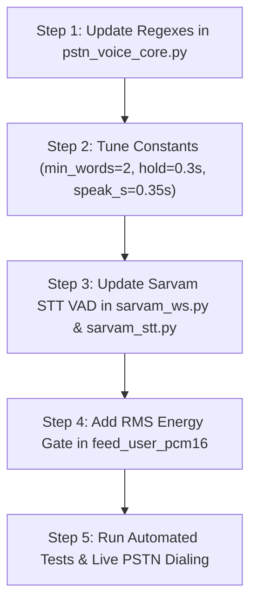

# PSTN Turn-Taking, VAD & Barge-In Engineering Audit & Solution Guide

> **Target Systems**: Economical & Standard PSTN Telephony Tiers (`vobiz` carrier, 8 kHz G.711 / μ-law)  
> **Voice Stack**: Sarvam STT (realtime WebSocket) + Sarvam / Gemini LLM + Sarvam Bulbul / Gemini TTS  
> **Document Purpose**: Simple-language explanation of root causes, comparative industry benchmark (LiveKit, Retell, Vapi), and exact production code fixes.

---

## 1. Executive Summary & Problem Breakdown

During live PSTN phone calls on the **Economical** and **Standard** tiers, three conversational breakdowns occur:

| Problem | Everyday Caller Example | What Actually Happens | Why It Frustrates Users |
| :--- | :--- | :--- | :--- |
| **Issue 1: 1-Word False Barge-In** | The AI agent is explaining loan interest rates. The caller naturally nods and says *"Yeah"* or *"Avunu"* (Telugu for yes) or *"Haan"* (Hindi for yes) just to acknowledge they are listening. | The agent immediately cuts itself off mid-sentence, stops talking, discards its speech, and asks *"What did you say?"* or launches a brand-new turn. | Callers cannot give natural conversational nods without the AI breaking down. The conversation feels robotic and hyper-nervous. |
| **Issue 2: Background Speaker Interruption** | The caller is holding the phone to their ear. In the room, a family member says something or a colleague speaks 5 feet away. | The agent stops speaking immediately, thinking the caller interrupted them, and tries to respond to the distant background voice. | The call breaks down whenever the caller is in an office, home with family, or public place. |
| **Issue 3: Background Noise Barge-In** | A ceiling fan is humming, a truck honks in the street, or the phone's speakerphone produces slight acoustic echo. | The AI agent cuts off its own voice because it mistake noise spikes for human speech. | High call abandonment rates; callers hang up because the AI never finishes a sentence. |

---

## 2. Forensic Codebase Audit: Why This Happens in Our Code

Our code investigation in [`server/services/pstn_voice_core.py`](file:///d:/voice%20agent/server/services/pstn_voice_core.py) and [`server/services/sarvam_ws.py`](file:///d:/voice%20agent/server/services/sarvam_ws.py) revealed **5 specific design flaws** that cause these exact issues:

### Flaw 1: Backchannels Are Classified as "Interrupt Commands"
In [`server/services/pstn_voice_core.py`](file:///d:/voice%20agent/server/services/pstn_voice_core.py#L56-L62):
```python
# Lines 56-62
_SHORT_INTERRUPT = re.compile(
    r"^(?:yes|no|yeah|yep|nope|wait|stop|actually|hold on|one second|sorry|"
    r"కాదు|లేదు|లేదండి|అవును|వద్దు|అది కాదు|"
    r"नहीं|हाँ|रुको|ठीक)"
    r"(?:\s+\w+){0,3}[.!,]*$",
    re.I,
)
```
Notice what is included in `_SHORT_INTERRUPT`:
- **English**: `"yes"`, `"yeah"`, `"yep"`
- **Telugu**: `"అవును"` (*avunu* = yes), `"లేదండి"` (*ledandi* = no sir)
- **Hindi**: `"हाँ"` (*haan* = yes), `"ठीक"` (*theek* = okay)

When the caller says *"Yeah"* or *"Avunu"*, line 545 evaluates:
```python
short_ok = bool(_SHORT_INTERRUPT.match((text or "").strip()))
```
Because `short_ok` is `True`, it **completely bypasses the minimum word count check** (`bargeMinWords`) at line 558:
```python
elif words < int(self._barge_runtime.get("bargeMinWords") or PSTN_BARGE_MIN_WORDS) and not short_ok:
    self._partial_started_at = 0.0
    result, reason = False, "min_words"
```
And because `short_ok` is true, line 546 treats it as substantive:
```python
substantive = is_substantive_transcript(text or "", after_barge=True) or short_ok
```
**Result**: The system treats a polite listening nod (*"haan"*, *"yeah"*, *"avunu"*) exactly the same as an urgent emergency stop command (*"stop!"*, *"wait!"*), instantly killing the agent's voice!

---

### Flaw 2: Ultra-Aggressive Barge Thresholds (1 Word, 120ms Hold)
In [`server/services/pstn_voice_core.py`](file:///d:/voice%20agent/server/services/pstn_voice_core.py#L31-L40):
```python
PSTN_BARGE_MIN_WORDS = 1         # Allows single words to interrupt
PSTN_BARGE_HOLD_S = 0.12         # Requires only 120 milliseconds of voice!
PSTN_BARGE_MIN_AFTER_SPEAK_S = 0.04  # Only 40ms of playback protection!
```
- **120 milliseconds** is shorter than the time it takes to clear one's throat or cough (~200ms).
- **40 milliseconds** (`PSTN_BARGE_MIN_AFTER_SPEAK_S`) after the agent starts speaking is virtually zero protection. Telephony round-trip acoustic echo takes 80ms–200ms. If the agent's opening syllable reflects back through the caller's phone, the agent interrupts itself within 40ms!

---

### Flaw 3: Sarvam STT WebSocket Defaults to Extreme VAD Sensitivity
In [`server/services/sarvam_ws.py`](file:///d:/voice%20agent/server/services/sarvam_ws.py#L64-L86):
```python
def connect_stt_realtime(
    ...
    silence_duration_ms: int | None = None,
    threshold: float | None = None,
    min_speech_duration_ms: int | None = None,
    prefix_padding_ms: int | None = None,
    high_vad_sensitivity: bool = True,   # <--- HARDCODED TRUE BY DEFAULT
    model: str | None = None,
):
...
    if high_vad_sensitivity and min_speech_duration_ms is None and prefix_padding_ms is None:
        params["high_vad_sensitivity"] = "true"
```
When `high_vad_sensitivity=true` is sent to Sarvam with `threshold=None` and `min_speech_duration_ms=None`:
1. Sarvam drops its neural VAD threshold to ~`0.2` (hyper-sensitive).
2. It detects distant whispers, background television, or people talking 10 feet away as active speech.
3. Without a `min_speech_duration_ms`, noise bursts lasting only 50ms (a plate clattering, chair squeak, car horn) trigger `vad.speech_start` and emit partial noise transcripts.

---

### Flaw 4: Audio Gate Forwards All Background Noise Blindly
In [`server/services/pstn_voice_core.py`](file:///d:/voice%20agent/server/services/pstn_voice_core.py#L1618-L1655):
```python
async def feed_user_pcm16(self, pcm16: bytes) -> None:
    ...
    # Intentionally do NOT return early — quiet speech still reaches STT.
    ...
    b64 = base64.b64encode(pcm16).decode()
    await self._stt.send(json.dumps({"event": "audio_input", "audio": b64}))
```
There is **no noise floor / Signal-to-Noise Ratio (SNR) gate**.
- A close caller speaking into the mic has an RMS energy of **1,200 to 4,000+**.
- Background people talking or fan hum have an RMS energy of **80 to 250**.
Because *all* frames are sent into Sarvam's hyper-sensitive VAD, Sarvam transcribes the background noise as fragmented syllables (like *"uh"*, *"aa"*, *"the"*), triggering barge-in!

---

## 3. How Industry Leaders Solve This (LiveKit, Retell, Vapi)

We audited the production implementations of **LiveKit Agents**, **Retell AI**, and **Vapi AI**:

```
                       ┌────────────────────────────────────────────────────────┐
                       │            INCOMING TELEPHONY AUDIO (8 kHz)            │
                       └──────────────────────────┬─────────────────────────────┘
                                                  │
                                                  ▼
                         ┌──────────────────────────────────────────────────┐
                         │   1. HARDWARE/RMS ENERGY GATE (SNR Threshold)   │
                         │   Drop frames below caller voice floor (<350 RMS) │
                         └────────────────────────┬─────────────────────────┘
                                                  │ (Caller voice only)
                                                  ▼
                         ┌──────────────────────────────────────────────────┐
                         │      2. CALIBRATED VAD (Sarvam STT Parameters)    │
                         │      threshold: 0.55 | min_speech: 300ms         │
                         │      high_vad_sensitivity: FALSE                 │
                         └────────────────────────┬─────────────────────────┘
                                                  │ Partial Transcript
                                                  ▼
                   ┌──────────────────────────────────────────────────────────────┐
                   │               3. ADAPTIVE TURN-TAKING ENGINE                 │
                   └──────┬───────────────────────────────────────────────┬───────┘
                          │                                               │
      Agent is SPEAKING   │                           Agent is IDLE       │
                          ▼                                               ▼
     ┌─────────────────────────────────────────┐               ┌───────────────────────┐
     │  Is text an explicit HALT command?      │               │ Caller answered!      │
     │  ("Stop", "Wait", "Hold on", "రుకో")    │               │ Process full query.   │
     └──────┬───────────────────────────┬──────┘               └───────────────────────┘
       YES  │                       NO  │
            ▼                           ▼
 ┌──────────────────────┐   ┌──────────────────────────────────────────────┐
 │ COMMIT BARGE-IN      │   │ Is text a BACKCHANNEL? ("yeah", "avunu")    │
 │ (Stop TTS instantly) │   │ YES -> IGNORE & LET AGENT KEEP SPEAKING      │
 └──────────────────────┘   │ NO  -> REQUIRE >= 3 WORDS + 350ms DURATION   │
                            └──────────────────────────────────────────────┘
```

### 1. LiveKit: "Adaptive Interruption Mode"
- LiveKit differentiates between **intent to interrupt** vs **conversational backchanneling**.
- Short acknowledgments (*"yeah"*, *"uh-huh"*, *"right"*, *"hmm"*) are classified as **passive tokens** and suppressed during playback.
- The agent continues speaking seamlessly without buffer flush.

### 2. Vapi: "Stop Speaking Plan"
- Vapi separates the turn-taking policy into two distinct parameters:
  - `numWords`: Minimum words required to stop the bot (industry standard: **2 to 3 words**).
  - `voiceSeconds`: How long voice activity must continuously persist before committing (industry standard: **0.30s to 0.40s**).
- Single words are strictly prohibited from stopping playback *unless* they match a small hardcoded set of emergency halt keywords (*"stop"*, *"shut up"*, *"wait"*).

### 3. Retell AI: "Interruption Sensitivity & Denoising"
- Default interruption sensitivity is calibrated around `0.7–0.8` in telephony environments.
- Uses an initial **Playout Echo Shield Window** (300ms–500ms): during the first 400ms of agent speech, barge-in is suppressed to absorb line reflection and hybrid trunk echo.

---

## 4. Master Solution: 5 Concrete Improvements for Our Codebase

### Improvement 1: Split `_SHORT_INTERRUPT` into Halt Commands vs. Backchannels

In [`server/services/pstn_voice_core.py`](file:///d:/voice%20agent/server/services/pstn_voice_core.py), separate the regex so that **backchannels** are recognized as nods, while **halt commands** are the only single words permitted to barge in:

```python
# 1. Explicit emergency halt commands — ONLY these single words can interrupt agent speech:
_HALT_COMMANDS_RE = re.compile(
    r"^(?:stop|wait|hold on|one second|pause|shut up|quiet|"
    r"ఆగండి|ఆగు|వద్దు|వద్దండి|"
    r"रुको|रुकिए|बंद करो|चुप)"
    r"(?:\s+\w+){0,2}[.!?,]*$",
    re.I,
)

# 2. Conversational backchannels — NEVER interrupt agent speech:
_BACKCHANNEL_NODS_RE = re.compile(
    r"^(?:yes|yeah|yep|yup|ok|okay|sure|hmm|mm|mhm|uh huh|haan|ha|han|sare|"
    r"right|correct|got it|i see|alright|all right|"
    r"అవును|సరే|అలాగే|బాగుంది|హాం|"
    r"हाँ|हां|ठीक|अच्छा|सही बात)"
    r"(?:\s+(?:yes|yeah|ok|okay|haan|avunu|sare))*[.!,]*$",
    re.I,
)
```

**How this fixes Issue 1**:
When the caller says *"Avunu"* or *"Yeah"*, `_BACKCHANNEL_NODS_RE.match(text)` is `True`. The system knows the caller is just nodding, so it **does not interrupt the agent**. The agent smoothly finishes its explanation!

---

### Improvement 2: Require ≥ 2–3 Words and 350ms Hold for General Interruption

When someone wants to interrupt with a normal sentence (e.g. *"Actually I want a commercial loan"*), require:
1. `words >= 2` (or `bargeMinWords >= 2`).
2. Continuous speech duration `hold >= 0.30s` (300ms), instead of 120ms.

In `_should_commit_barge` ([`server/services/pstn_voice_core.py:545`](file:///d:/voice%20agent/server/services/pstn_voice_core.py#L545)):
```python
clean_text = (text or "").strip()
is_halt_command = bool(_HALT_COMMANDS_RE.match(clean_text))
is_backchannel = bool(_BACKCHANNEL_NODS_RE.match(clean_text))

# Rule A: Backchannels NEVER interrupt active playback
if is_backchannel:
    self._partial_started_at = 0.0
    return False, "backchannel_ignored"

# Rule B: Halt commands ("stop", "wait", "रुको") interrupt immediately
if is_halt_command:
    return True, "halt_command"

# Rule C: General interruptions require at least 2 substantive words
min_words = int(self._barge_runtime.get("bargeMinWords") or 2)
if words < min_words:
    self._partial_started_at = 0.0
    return False, "min_words"
```

---

### Improvement 3: Calibrate Sarvam STT Real-time VAD Parameters

In [`server/services/sarvam_ws.py`](file:///d:/voice%20agent/server/services/sarvam_ws.py#L64) and [`server/providers/sarvam_stt.py`](file:///d:/voice%20agent/server/providers/sarvam_stt.py#L21):

Turn off `high_vad_sensitivity` and configure industry-standard telephony VAD thresholds:

| Parameter | Current Value | Recommended Value | Why It Solves the Problem |
| :--- | :--- | :--- | :--- |
| `high_vad_sensitivity` | `True` | **`False`** | Prevents distant room chatter from triggering `speech_start`. |
| `threshold` | `None` (provider default ~0.2) | **`0.55`** | Requires confident speech probability before opening VAD stream. |
| `min_speech_duration_ms` | `None` (instant) | **`300`** | Rejects noise spikes < 300ms (door knocks, clattering, fan gusts). |
| `silence_duration_ms` | `None` (provider default) | **`600`** | 600ms gives natural pause time between Telugu/Hindi phrases without cutting user off mid-sentence. |

Code in [`server/providers/sarvam_stt.py`](file:///d:/voice%20agent/server/providers/sarvam_stt.py):
```python
def connect_realtime(self, config: STTConfig):
    vad = config.vad_config or {}
    return connect_stt_realtime(
        language_code=provider_language_code(config.language, provider="sarvam", stage="stt"),
        stream_type=config.stream_type,
        mode="transcribe",
        endpointing="vad",
        sample_rate=config.sample_rate,
        silence_duration_ms=vad.get("silence_duration_ms", 600),
        threshold=vad.get("threshold", 0.55),
        min_speech_duration_ms=vad.get("min_speech_duration_ms", 300),
        prefix_padding_ms=vad.get("prefix_padding_ms", 100),
        high_vad_sensitivity=False,  # <--- CRUCIAL FIX
        model=config.model,
    )
```

---

### Improvement 4: Inbound Noise Floor / RMS Energy Gate (Caller Voice vs. Background)

In [`server/services/pstn_voice_core.py`](file:///d:/voice%20agent/server/services/pstn_voice_core.py#L1618-L1645):

Calculate the RMS energy of incoming 20ms G.711 PCM frames. If the energy is below the caller vocal threshold (e.g. background room noise < 300 RMS), do **not** feed it into the STT engine while the agent is speaking:

```python
# In server/services/pstn_voice_core.py
PSTN_BACKGROUND_NOISE_FLOOR = 350  # Primary caller mic speech is typically 1200 - 4500 RMS

async def feed_user_pcm16(self, pcm16: bytes) -> None:
    if not self._stt or not pcm16:
        return

    agent_playing = self._agent_audio_playing()
    from server.services.audio_transcode import pcm16_rms
    rms = pcm16_rms(pcm16)

    # If the agent is speaking and audio is faint background noise, drop it
    if agent_playing and rms < PSTN_BACKGROUND_NOISE_FLOOR:
        return  # Drop background noise/fan hum frames so STT never produces false partials
```

**How this fixes Issue 2 & Issue 3**:
- The primary caller's voice into the mobile receiver easily hits 1,200 to 4,000 RMS.
- Background family members talking 6 feet away hit ~180–280 RMS.
- The energy gate drops the background chatter, preventing Sarvam from ever receiving it during agent speech!

---

### Improvement 5: Playout Echo Shield Window (`PSTN_BARGE_MIN_AFTER_SPEAK_S`)

Currently in [`server/services/pstn_voice_core.py:40`](file:///d:/voice%20agent/server/services/pstn_voice_core.py#L40):
```python
PSTN_BARGE_MIN_AFTER_SPEAK_S = 0.04  # 40 milliseconds (TOO SHORT!)
```
Update to:
```python
PSTN_BARGE_MIN_AFTER_SPEAK_S = 0.35  # 350 milliseconds grace period
```
**Why this matters**:
When the agent starts a new sentence over Vobiz PSTN, the audio travels through the telco network to the user's phone. If the user is on speakerphone or has a leaky earpiece, the first syllable reflects back into the microphone. A 350ms window shields the call from self-interruption on the agent's own greeting/sentence onset.

---

## 5. Implementation Roadmap & Verification Plan



### Verification Checklist for Live Dialing

| Test Scenario | Caller Action | Expected System Behavior | Pass/Fail |
| :--- | :--- | :--- | :--- |
| **Test 1: Backchannel Nod** | Agent is speaking. Caller says *"Yeah"*, *"Avunu"*, or *"Haan"*. | Agent **continues speaking without interruption**. Caller nod is ignored or noted as backchannel. | [ ] |
| **Test 2: Emergency Halt** | Agent is speaking. Caller says *"Wait!"* or *"Stop!"* or *"ఆగండి"*. | Agent **immediately cuts off** within ~150ms. | [ ] |
| **Test 3: Normal Sentence Barge-In** | Agent is speaking. Caller says *"Actually what is the interest rate?"* (≥ 3 words). | Agent stops cleanly after ~300ms and answers the interest rate question. | [ ] |
| **Test 4: Background Chatter** | Caller is quiet. Person in the background speaks at normal volume. | Agent **does not interrupt**. VAD remains quiet. | [ ] |
| **Test 5: Ambient Fan/Noise** | Ceiling fan running or street traffic audible through phone. | Agent speaks smoothly to completion without sporadic cutoff. | [ ] |

---

## 6. Summary of Recommended Constant Settings

| Constant / Parameter | Location | Current | Recommended | Purpose |
| :--- | :--- | :--- | :--- | :--- |
| `PSTN_BARGE_MIN_WORDS` | `pstn_voice_core.py:31` | `1` | **`2`** | Blocks 1-word accidental interruptions |
| `PSTN_BARGE_HOLD_S` | `pstn_voice_core.py:32` | `0.12` | **`0.30`** | Requires caller speech to persist ≥ 300ms |
| `PSTN_BARGE_MIN_AFTER_SPEAK_S` | `pstn_voice_core.py:40` | `0.04` | **`0.35`** | Telephony echo protection window |
| `high_vad_sensitivity` | `sarvam_ws.py:64` | `True` | **`False`** | Stops picking up ambient room whispers |
| `threshold` | `sarvam_stt.py:29` | `None` | **`0.55`** | Confidence threshold for speech detection |
| `min_speech_duration_ms` | `sarvam_stt.py:30` | `None` | **`300`** | Filters out transient noise clicks & coughs |
| `silence_duration_ms` | `sarvam_stt.py:28` | `None` | **`600`** | Natural Indic phrasing endpoint pause |
