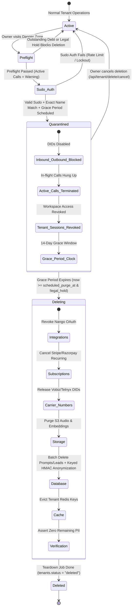

# Tenant Account Deletion ("Danger Zone") — Architecture & Implementation Plan

**Document Version:** 1.1.0  
**Status:** Authoritative Specification & Implementation Directive  
**Target Stack:** FastAPI (Python 3.12, SQLAlchemy Async, Redis), PostgreSQL, React 18 / Vite (`voxly-ai`), Telephony (Vobiz & Telnyx), Nango Gateway, Razorpay / Stripe  

> [!IMPORTANT]
> **Precedence Rule:** Where any earlier design notes or RFCs conflict with this document, this specification wins. Do not modify production application code until the gap analysis and migration phases are reviewed.

---

## Step 0 — Codebase Audit & Gap Analysis

An authoritative audit of the active repository was conducted against the deletion requirements:

| Component / File | Existing State in Codebase | What is Missing / Gaps | Conflicts with v1.0 Spec |
| :--- | :--- | :--- | :--- |
| **Tenant Routing & Admin**<br>[`server/routes/app_admin.py`](file:///d:/voice%20agent/server/routes/app_admin.py#L350-L375) | Contains platform superadmin brute-force route `DELETE /api/admin/tenants/{tenant_id}` that runs cascading raw SQL statements. | Lacks self-serve tenant owner endpoints (`/api/tenant/delete*`), preflight checks, re-auth challenges, grace period management, and export endpoints. | v1.0 suggested `/api/tenant/delete-request` and `/api/tenant/delete`. **Resolved in v1.1:** Standardized on single prefix `/api/tenant/delete*`. |
| **Teardown Worker**<br>[`server/services/saas/teardown_worker.py`](file:///d:/voice%20agent/server/services/saas/teardown_worker.py) | Contains skeleton `process_one_teardown()` setting `tenant.status = "deleted"`, archiving agents, and marking numbers released. | Lacks stage-by-stage checkpointing, crash-and-resume, distributed locking, Nango token deletion, carrier DID release APIs, S3 audio purge, keyed HMAC anonymization, and Redis eviction. | v1.0 executed teardown immediately. **Resolved in v1.1:** Worker executes ONLY after `scheduled_purge_at` and verifies `legal_hold is False`. |
| **Teardown Job Model**<br>[`server/db/models/saas_models.py`](file:///d:/voice%20agent/server/db/models/saas_models.py#L124-L134) | `TenantTeardownJob` has `job_id`, `tenant_id`, `status`, `payload`, `last_error`, `created_at`, `updated_at`. | Lacks `stage` enum, `attempts`, `locked_by`, `locked_until`, `idempotency_key`, `completed_at`, and partial index for single active job. | Schema must be migrated to support resilient multi-stage state machine. |
| **Active Call Store**<br>[`server/call/call_store.py`](file:///d:/voice%20agent/server/call/call_store.py) | Tracks live PSTN/WebSocket sessions in Redis/memory. | Lacks a batch `terminate_tenant_calls(tenant_id)` method to hang up ongoing calls upon quarantine. | v1.0 blocked deletion if calls were active. **Resolved in v1.1:** Active calls are a **warning, NOT a blocker**; calls are terminated post-commit. |
| **Authentication & Sudo Re-auth**<br>[`server/services/saas/auth_service.py`](file:///d:/voice%20agent/server/services/saas/auth_service.py) | Has `verify_portal_password()` and rate limiters. | Lacks passwordless/SSO email OTP fallback for re-authentication; lacks rate-limiting lockout specific to destructive tenant deletion. | Password verify field must NOT enforce `min_length=8` (verify-only input). |
| **Session & Token Models**<br>[`server/db/models/saas_models.py`](file:///d:/voice%20agent/server/db/models/saas_models.py#L69-L91) | `RefreshToken` maps `user_id` to token hash. | Does not record tenant scope directly on the token. Revoking all tokens for a user would log them out of other workspaces. | **Resolved in v1.1:** Only revoke refresh tokens or sessions associated with the quarantined tenant. Multi-tenant users remain logged into other workspaces. |
| **Integrations & Carrier Trunks**<br>[`server/services/nango_service.py`](file:///d:/voice%20agent/server/services/nango_service.py), [`telephony.py`](file:///d:/voice%20agent/server/services/telephony.py) | `nango_service.delete_connection()` exists. Vobiz and Telnyx inventory exists. | No orchestrated carrier deprovisioning pipeline triggered on account teardown. | Must handle external carrier/Nango 404s idempotently without failing the pipeline. |
| **Frontend Console**<br>[`voxly-ai/src/console/modules/SettingsModule.jsx`](file:///d:/voice%20agent/voxly-ai/src/console/modules/SettingsModule.jsx) | Has password change, KYC, session security, and wallet cards. | Completely lacks a Danger Zone card, confirmation modal, grace period cancel banner, and global `tenant_quarantined` error interceptor. | UI must be strictly scrubbed of wholesale carrier/vendor names (`Vobiz`, `Telnyx`, `Nango`). |

---

## 1. Regulatory & Industry Standards Compliance Matrix

| Regulation / Standard | Mandate | Application to Voxly AI |
| :--- | :--- | :--- |
| **GDPR (Art. 17 & 20) / India DPDP Act 2023** | **Right to be Forgotten & Data Portability**: Users have the right to erase all PII and export their data prior to account deletion. | • Pre-deletion Data Export ("Takeout") generates an encrypted ZIP of call logs, contacts, and prompts.<br>• Complete purge of audio recordings from S3, transcripts, contacts, leads, and custom prompts. |
| **Telecom Regulations (TRAI/DoT, FCC, Ofcom)** | **Lawful CDR Metadata Retention**: Telecom service providers are legally required to retain Call Detail Record (CDR) metadata for 1–2 years for fraud and regulatory audits. | • Retain anonymized CDR audit rows (timestamps, call duration, anonymized hashes) while purging raw audio files and conversation transcripts. |
| **Tax & Accounting (IRS, GST India, EU VAT, SOC 2)** | **Financial Ledger Inviolability**: Invoices and settled transactions cannot be destroyed; must be retained for 5–7 years. | • Preserve `billing_invoices` and `razorpay_orders` with PII anonymized.<br>• Wallet balances frozen; positive balances require explicit forfeiture confirmation or refund handling. |
| **OWASP & NIST SP 800-63B** | **Sudo Re-Authentication & CSRF Defense**: High-impact destructive operations must re-verify authentication and user intent. | • Enforce password challenge (or OTP for passwordless/SSO users) and exact workspace name confirmation.<br>• Strict RBAC: Only `role == "owner"` can initiate deletion. |
| **Fault Tolerance & Reliability** | **Two-Phase Asynchronous Teardown**: Long-running carrier deprovisioning and S3 purges must never block HTTP threads. | • Phase 1 (Sync): Immediately quarantines the tenant and enqueues a job.<br>• Phase 2 (Async): Background worker executes idempotent stages with checkpointing and backoff. |

---

## 2. Tenant Lifecycle & State Machine



---

## 3. Phase 1 — Database Schema & Migration `032`

### 3.1 Migration Specifications
- **`tenants` table updates:**
  - `status`: CHECK constraint / enum: `active`, `quarantined`, `deleting`, `deleted`.
  - `deleted_at`: `DateTime(timezone=True)`, nullable.
  - `deleted_by_user_id`: `UUID`, nullable (foreign key to `users.user_id`).
  - `deletion_reason`: `String(255)`, nullable.
  - `scheduled_purge_at`: `DateTime(timezone=True)`, nullable.
  - `restored_at`: `DateTime(timezone=True)`, nullable.
  - `legal_hold`: `Boolean`, server_default=`False`, nullable=False.
- **`tenant_teardown_jobs` table updates:**
  - `stage`: Canonical enum: `queued`, `integrations`, `subscriptions`, `carrier_numbers`, `storage`, `database`, `cache`, `verification`, `done`.
  - `attempts`: `Integer`, server_default=`0`, nullable=False.
  - `last_error`: `JSONB`, nullable=True.
  - `locked_by`: `String(64)`, nullable=True.
  - `locked_until`: `DateTime(timezone=True)`, nullable=True.
  - `idempotency_key`: `String(128)`, nullable=False.
  - `completed_at`: `DateTime(timezone=True)`, nullable=True.
  - **Unique partial index:** `uq_tenant_teardown_active` on `(tenant_id)` where `status IN ('queued', 'running')` to enforce strictly **one active teardown job per tenant**.
- **`tenant_export_jobs` table creation:**
  - `job_id`: `UUID`, primary key.
  - `tenant_id`: `UUID`, foreign key to `tenants.tenant_id`.
  - `user_id`: `UUID`, foreign key to `users.user_id`.
  - `status`: `String(30)`, server_default=`"queued"`, nullable=False.
  - `download_url`: `String(512)`, nullable=True.
  - `expires_at`: `DateTime(timezone=True)`, nullable=True.
  - `created_at`: `DateTime(timezone=True)`, server_default=`now()`, nullable=False.
  - Indexes on `(tenant_id, created_at)` and `(user_id)`.

### 3.2 Alembic Migration Code: `server/db/migrations/versions/032_tenant_deletion_flow.py`

```python
"""Tenant deletion flow, teardown stages, and export jobs.

Revision ID: 032_tenant_deletion_flow
Revises: 031_wallet_tx_reference_unique
Create Date: 2026-10-13 15:00:00.000000
"""
from __future__ import annotations

import sqlalchemy as sa
from alembic import op
from sqlalchemy.dialects import postgresql

revision = "032_tenant_deletion_flow"
down_revision = "031_wallet_tx_reference_unique"
branch_labels = None
depends_on = None


def upgrade() -> None:
    # 1. Update tenants table
    op.add_column("tenants", sa.Column("deleted_at", sa.DateTime(timezone=True), nullable=True))
    op.add_column("tenants", sa.Column("deleted_by_user_id", postgresql.UUID(as_uuid=True), nullable=True))
    op.add_column("tenants", sa.Column("deletion_reason", sa.String(255), nullable=True))
    op.add_column("tenants", sa.Column("scheduled_purge_at", sa.DateTime(timezone=True), nullable=True))
    op.add_column("tenants", sa.Column("restored_at", sa.DateTime(timezone=True), nullable=True))
    op.add_column("tenants", sa.Column("legal_hold", sa.Boolean(), server_default="false", nullable=False))
    
    # Check constraint on tenants status
    op.create_check_constraint(
        "ck_tenants_status",
        "tenants",
        "status IN ('active', 'quarantined', 'deleting', 'deleted')"
    )

    # 2. Update tenant_teardown_jobs table
    op.add_column("tenant_teardown_jobs", sa.Column("stage", sa.String(50), server_default="queued", nullable=False))
    op.add_column("tenant_teardown_jobs", sa.Column("attempts", sa.Integer(), server_default="0", nullable=False))
    op.add_column("tenant_teardown_jobs", sa.Column("locked_by", sa.String(64), nullable=True))
    op.add_column("tenant_teardown_jobs", sa.Column("locked_until", sa.DateTime(timezone=True), nullable=True))
    op.add_column("tenant_teardown_jobs", sa.Column("idempotency_key", sa.String(128), nullable=True))
    op.add_column("tenant_teardown_jobs", sa.Column("completed_at", sa.DateTime(timezone=True), nullable=True))
    
    # Partial unique index: one active teardown job per tenant
    op.create_index(
        "uq_tenant_teardown_active",
        "tenant_teardown_jobs",
        ["tenant_id"],
        unique=True,
        postgresql_where=sa.text("status IN ('queued', 'running')")
    )

    # 3. Create tenant_export_jobs table
    op.create_table(
        "tenant_export_jobs",
        sa.Column("job_id", postgresql.UUID(as_uuid=True), primary_key=True, server_default=sa.text("gen_random_uuid()")),
        sa.Column("tenant_id", postgresql.UUID(as_uuid=True), sa.ForeignKey("tenants.tenant_id", ondelete="CASCADE"), nullable=False),
        sa.Column("user_id", postgresql.UUID(as_uuid=True), sa.ForeignKey("users.user_id"), nullable=False),
        sa.Column("status", sa.String(30), server_default="queued", nullable=False),
        sa.Column("download_url", sa.String(512), nullable=True),
        sa.Column("expires_at", sa.DateTime(timezone=True), nullable=True),
        sa.Column("created_at", sa.DateTime(timezone=True), server_default=sa.func.now(), nullable=False),
    )
    op.create_index("ix_tenant_export_jobs_tenant_created", "tenant_export_jobs", ["tenant_id", "created_at"])
    op.create_index("ix_tenant_export_jobs_user_id", "tenant_export_jobs", ["user_id"])


def downgrade() -> None:
    op.drop_index("ix_tenant_export_jobs_user_id", table_name="tenant_export_jobs")
    op.drop_index("ix_tenant_export_jobs_tenant_created", table_name="tenant_export_jobs")
    op.drop_table("tenant_export_jobs")

    op.drop_index("uq_tenant_teardown_active", table_name="tenant_teardown_jobs")
    op.drop_column("tenant_teardown_jobs", "completed_at")
    op.drop_column("tenant_teardown_jobs", "idempotency_key")
    op.drop_column("tenant_teardown_jobs", "locked_until")
    op.drop_column("tenant_teardown_jobs", "locked_by")
    op.drop_column("tenant_teardown_jobs", "attempts")
    op.drop_column("tenant_teardown_jobs", "stage")

    op.drop_constraint("ck_tenants_status", "tenants", type_="check")
    op.drop_column("tenants", "legal_hold")
    op.drop_column("tenants", "restored_at")
    op.drop_column("tenants", "scheduled_purge_at")
    op.drop_column("tenants", "deletion_reason")
    op.drop_column("tenants", "deleted_by_user_id")
    op.drop_column("tenants", "deleted_at")
```

---

## 4. Phase 2 — API Endpoints Specification (`/api/tenant/delete*`)

All endpoints use single prefix naming: `/api/tenant/delete*` and `/api/tenant/export*`.  
`tenant_id` is extracted strictly from `SubscriberPrincipal` (no URL tenant manipulation permitted).

### 4.1 Preflight Check: `GET /api/tenant/delete-preflight`
- **Auth:** `require_subscriber_jwt`. Caller must be `owner` via `scalar_one_or_none()` on `tenant_memberships`. Non-owners receive `403 Forbidden`.
- **Logic:**
  1. Count active phone numbers, agents, campaigns, and Nango integrations.
  2. Query `BillingWallet` balances (USD and INR).
  3. Query `call_store` for live calls.
  4. Query unpaid invoices (`billing_invoices.status == 'unpaid'`).
  5. Check `tenant.legal_hold`.
- **Blocking vs Warning Semantics:**
  - **Blocking Reasons (Prevents Deletion):** Outstanding unpaid debt or active `legal_hold == True`.
  - **Warnings (Does NOT Block Deletion):** Active calls running (will be hung up), wallet balance > 0 (will be forfeited), active phone numbers (will be released).
- **Response Format:**
  ```json
  {
    "canDelete": true,
    "tenantName": "Acme Voice",
    "warnings": [
      "2 active phone numbers will be released immediately.",
      "Your balance of $45.00 / ₹3,700 will be forfeited upon completion.",
      "1 call is currently in progress and will be immediately terminated."
    ],
    "blockingReasons": [],
    "activeCallsCount": 1,
    "phoneNumbersCount": 2,
    "agentsCount": 3,
    "walletBalanceUsd": 45.00,
    "walletBalanceInr": 3700.00,
    "gracePeriodDays": 14
  }
  ```

### 4.2 Quarantine & Delete Scheduling: `POST /api/tenant/delete`
- **Auth:** `require_subscriber_jwt`. Owner only (`role == "owner"`).
- **Request Body:**
  ```python
  class DeleteTenantBody(BaseModel):
      current_password: str | None = None   # No min_length constraint on verify-only field
      otp_code: str | None = None           # Fallback for SSO / passwordless users
      confirmation_name: str                # Must match tenant.name exactly
      reason: str | None = Field(None, max_length=255)
      forfeit_balance_confirmed: bool = False
  ```
- **Handler Execution Steps:**
  1. **Lockout & Rate Limiting:** Enforce a 5-attempt rate limiter (`RateLimiter(max_requests=5, window_s=900)`). If exceeded, return `429 Too Many Requests`.
  2. **Re-Authentication Challenge:**
     - If user has a `password_hash`, verify via `verify_portal_password(body.current_password, user.password_hash)`.
     - If user is SSO/passwordless, verify via `otp_code` against `email_verification_tokens`.
     - Invalid credentials return `400 Bad Request` and increment failure counter.
  3. **Confirmation Name Match:** Assert `body.confirmation_name.strip() == tenant.name.strip()`. Mismatch returns `400 Bad Request`.
  4. **Balance Confirmation Check:** If wallet balance > 0 and `forfeit_balance_confirmed is False`, return `400 Bad Request` with message requiring forfeiture acknowledgment.
  5. **Atomic Transaction (`SELECT ... FOR UPDATE`):**
     - Acquire row lock on `tenants`: `SELECT * FROM tenants WHERE tenant_id = :tid FOR UPDATE`.
     - Assert `tenant.status == 'active'` and `tenant.legal_hold is False`.
     - Re-run unpaid debt checks. If debt exists, abort with `400 Bad Request`.
     - Update tenant:
       ```python
       tenant.status = "quarantined"
       tenant.deleted_at = _utcnow()
       tenant.deleted_by_user_id = principal.user_id
       tenant.deletion_reason = body.reason
       tenant.scheduled_purge_at = _utcnow() + timedelta(days=settings.tenant_deletion_grace_days) # default 14
       ```
     - Disable numbers: Update `phone_numbers` setting `inbound_enabled=False, outbound_enabled=False`.
     - Pause campaigns: Update `campaigns` setting `status='paused'`.
     - Revoke session tokens: Invalidate `RefreshToken` rows matching users who belong **only** to this tenant.
     - Enqueue `TenantTeardownJob`:
       ```python
       job = TenantTeardownJob(
           tenant_id=tenant.tenant_id,
           status="queued",
           stage="queued",
           idempotency_key=f"teardown:{tenant.tenant_id}:{int(tenant.deleted_at.timestamp())}",
           payload={"active_numbers_snapshot": [...], "initiated_by": str(principal.user_id)}
       )
       session.add(job)
       ```
  6. **Post-Commit Side Effects:**
     - Call `call_store.terminate_tenant_calls(tenant.tenant_id)` to terminate any in-flight WebSockets/calls.
     - Evict tenant cache keys in Redis (`tenant_tool_cache`, agent instructions, rate limiters).
     - Send transactional email to owner and admins: *"Workspace deletion scheduled for [scheduled_purge_at]. You may cancel before this date."*
     - Return `200 OK`: `{"status": "quarantined", "scheduledPurgeAt": tenant.scheduled_purge_at.isoformat()}`.

### 4.3 Cancel Deletion / Restore Workspace: `POST /api/tenant/delete/cancel`
- **Auth:** `require_subscriber_jwt`. Owner only.
- **Constraints:** Valid only during the grace period while `tenant.status == 'quarantined'` and `scheduled_purge_at > now()`.
- **Atomic Execution:**
  1. `SELECT * FROM tenants WHERE tenant_id = :tid FOR UPDATE`.
  2. Set `tenant.status = "active"`, `tenant.scheduled_purge_at = None`, `tenant.restored_at = _utcnow()`.
  3. Re-enable only the phone numbers that were enabled prior to quarantine (using the snapshot stored in `TenantTeardownJob.payload`).
  4. Mark pending `TenantTeardownJob.status = "cancelled"`.
  5. Emit `AuthEvent(event_type="tenant.restored")`.
  6. Return `{"status": "active", "message": "Workspace successfully restored."}`.

### 4.4 Data Export ("Takeout"): `POST /api/tenant/export` & `GET /api/tenant/export/{job_id}`
- **Auth:** `require_subscriber_jwt`. Owner only.
- **`POST /api/tenant/export`:**
  - Creates a `TenantExportJob(tenant_id=..., user_id=..., status="queued")`.
  - Dispatches background generation of encrypted ZIP containing:
    - `call_logs.csv` (call metadata and transcript summaries).
    - `contacts.csv` (telephony contacts and lead records).
    - `agent_prompts.json` (agent configurations and system prompts).
    - `billing_summary.json` (invoices and wallet transactions).
- **`GET /api/tenant/export/{job_id}`:**
  - Returns status and time-limited pre-signed URL (valid for 24 hours).
  - All download accesses are audit-logged in `auth_events`.

---

## 5. Phase 3 — Quarantine Enforcement (Fail-Closed Architecture)

Once a tenant is in `quarantined`, `deleting`, or `deleted` status, all runtime surfaces must **fail closed immediately**:

1. **Subscriber API Requests (`require_subscriber_jwt`):**
   - Inject tenant status verification in [`server/auth/subscriber_dependencies.py`](file:///d:/voice%20agent/server/auth/subscriber_dependencies.py).
   - If `tenant.status != "active"`, reject the request immediately with HTTP 403 and body:
     ```json
     {"error": "tenant_quarantined", "message": "This workspace is quarantined pending deletion.", "scheduledPurgeAt": "..."}
     ```
   - **Exception:** Allow `POST /api/tenant/delete/cancel` and `GET/POST /api/tenant/export*` during the grace period.
2. **Carrier Inbound & Outbound Webhooks:**
   - In [`server/routes/vobiz.py`](file:///d:/voice%20agent/server/routes/vobiz.py) and [`server/routes/telnyx.py`](file:///d:/voice%20agent/server/routes/telnyx.py), verify tenant status during DID resolution.
   - Non-active tenants return immediate SIP `486 Busy Here` / `404 Not Found` and reject call setup.
3. **Schedulers & Campaign Dispatchers:**
   - In [`server/campaigns/runner.py`](file:///d:/voice%20agent/server/campaigns/runner.py) and ARQ cron tasks, add filter: `WHERE tenants.status = 'active'`.

---

## 6. Phase 4 — Robust Teardown Worker Pipeline

The worker in [`server/services/saas/teardown_worker.py`](file:///d:/voice%20agent/server/services/saas/teardown_worker.py) operates autonomously as a background daemon.

### 6.1 Job Claiming & Locking
- Uses `SELECT * FROM tenant_teardown_jobs WHERE status = 'queued' AND scheduled_purge_at <= NOW() FOR UPDATE SKIP LOCKED LIMIT 1`.
- Sets `locked_by = worker_id`, `locked_until = NOW() + INTERVAL '10 minutes'`, and `status = 'running'`.
- Verifies `tenant.legal_hold is False`. If legal hold is set, aborts with status `"held_by_legal"`.

### 6.2 Checkpointed Stages & Idempotency
Each stage checkpoints `job.stage` in the database. If a worker crashes, the next iteration resumes from that exact stage without repeating completed work.

```
[queued] → (1) integrations → (2) subscriptions → (3) carrier_numbers → (4) storage → (5) database → (6) cache → (7) verification → [done]
```

#### Stage 1: `integrations`
- Query all `TenantIntegration` rows for `tenant_id`.
- For each row, invoke `nango_service.delete_connection(connection_id)`.
- **Idempotency:** Treat Nango HTTP 404 or `connection_not_found` as success.

#### Stage 2: `subscriptions`
- Cancel all active number subscriptions and tier plans via Stripe (`stripe.Subscription.delete()`) or Razorpay subscription APIs.
- Settle and close `billing_wallets`. Record final zero-balance settlement.

#### Stage 3: `carrier_numbers`
- Deprovision numbers from carrier voice trunks (Vobiz direct DIDs and Telnyx inventory).
- Update `phone_numbers`: `status = "released"`, `released_at = _utcnow()`, `tenant_id = None`.
- **Idempotency:** Treat carrier 404s or already-released DIDs as success.

#### Stage 4: `storage`
- Delete all audio recording objects (`.wav`, `.mp3`) from AWS S3 / Cloud Storage buckets, including versioned delete markers.
- Delete vector embeddings in vector stores (Chroma / PgVector) for business brains.
- Delete expired takeout ZIP files from export buckets.

#### Stage 5: `database`
- **Batched Deletes (Chunk size: 500 rows):**
  - Delete `prompts`, `business_brain_sections`, `business_brain_versions`, `agent_telephony_profiles`, `campaigns`, `campaign_contacts`, `leads`, `contacts`, `dnc_list`, `tool_executions`.
- **CDR Anonymization (Keyed HMAC):**
  - Retrieve secret salt `HMAC_PHONE_SALT` from environment / secrets manager.
  - Anonymize `calls.from_number` and `calls.to_number` with `HMAC-SHA256(salt, raw_e164)[:24]`.
  - Nullify raw transcripts, customer notes, and caller names.
  - Retain timestamp, duration, latency metrics, and anonymized hash for statutory telecom compliance.
- **Statutory Financial Retention:**
  - Preserve `billing_invoices` and `razorpay_orders` for 7 years (tax audit compliance).
  - Anonymize customer billing address, email, and personal name. Retain tax identifier (GSTIN/VAT), invoice number, currency, and settled minor amounts.
- **User Account Handling:**
  - Users belonging **only** to this tenant: Anonymize name/email, set `status = "deleted"`.
  - Users belonging to **multiple tenants**: Retain user row; delete only the `TenantMembership` link.

#### Stage 6: `cache`
- Evict all Redis keys matching `tenant:{tenant_id}:*`, `call_store` entries, rate limiters, and `tenant_tool_cache`.

#### Stage 7: `verification`
- Run assertion queries ensuring 0 active DIDs, 0 unencrypted transcripts, 0 S3 audio files, and 0 active sessions remain.
- Write a PII-free deletion certificate payload to `TenantTeardownJob.payload["certificate"]`.

#### Stage 8: `done`
- Update `tenants.status = "deleted"`, `tenant_teardown_jobs.status = "done"`, `completed_at = _utcnow()`.
- Emit PII-free audit event `AuthEvent(event_type="tenant.deleted")`.

### 6.3 Dedicated Retention Expiry Cron Job
- Add a periodic task (`purge_expired_retained_records`):
  - Invoices older than configured retention period (default 7 years).
  - CDR metadata older than configured retention period (default 2 years).
  - Config values declared in `server/config/env.py` with explicit `TODO(legal): Confirm statutory retention window with jurisdiction counsel`.

---

## 7. Phase 5 — Frontend UX & Settings Console (`voxly-ai`)

### 7.1 "Danger Zone" in [`SettingsModule.jsx`](file:///d:/voice%20agent/voxly-ai/src/console/modules/SettingsModule.jsx)
- Placed at the very bottom of Settings.
- Rendered with distinct red/destructive theme styling.
- Visible **only** if `user?.role === "owner"`.

### 7.2 Multi-Step Confirmation Modal
1. **Step 1: Impact & Preflight Review**
   - Calls `GET /api/tenant/delete-preflight`.
   - Displays count of voice agents, phone numbers, and integrations to be removed.
   - If wallet balance > 0, displays explicit warning and checkbox: *"I understand and agree to forfeit my remaining balance of $X.XX"*.
   - Displays link: *"Download workspace data archive (Takeout)"*.
2. **Step 2: Workspace Confirmation Input**
   - Requires typing the exact workspace name (e.g. `Acme Voice`). Red confirm button remains disabled until exact match.
   - Optional survey select: *"Reason for leaving"* (Too expensive, missing features, project ended, other).
3. **Step 3: Sudo Authentication**
   - Password input with reveal toggle (or OTP input button for SSO users).
4. **Step 4: Submission & Cleanup**
   - Sends `POST /api/tenant/delete`.
   - Handles errors gracefully (400 wrong password, 403 not owner, 429 rate limited).
   - On success: clears `voxly_auth_token` and sessionStorage, redirects to `/login?notice=workspace_quarantined`.

### 7.3 Grace Period Restoration Banner
- If an owner logs in during the 14-day grace period, show a sticky top banner:  
  *"This workspace is scheduled for permanent deletion on [Date]. [Cancel Deletion] [Export Data]"*.
- Clicking Cancel calls `POST /api/tenant/delete/cancel` and restores full access immediately.

### 7.4 Global Quarantine Error Interceptor
- When any open browser tab receives `{ "error": "tenant_quarantined" }` on any API call, the client immediately redirects to `/login?notice=workspace_quarantined`.
- **Strict Vendor Scrubbing:** Never show wholesale vendor names (`Vobiz`, `Telnyx`, `Nango`, `Stripe`) in UI text or error toasts. Use enterprise terms: *"Direct Voice Trunk"*, *"Enterprise Voice Network"*, *"CRM Integrations"*.

---

## 8. Phase 6 — Comprehensive Test Suite

Test suite located at `server/tests/test_tenant_deletion.py`.

| Test Scenario | Verification Objective |
| :--- | :--- |
| **RBAC Non-Owner Rejection** | Non-owner member attempting `POST /api/tenant/delete` receives `403 Forbidden`. |
| **IDOR Cross-Tenant Protection** | Assert `tenant_id` is derived strictly from JWT principal; cross-tenant body injection is ignored. |
| **Sudo Password Verification** | Incorrect password returns `400 Bad Request`; correct password succeeds. |
| **Name Mismatch Rejection** | Typing wrong workspace name returns `400 Bad Request`. |
| **Balance Forfeiture Enforcement**| Positive wallet balance without `forfeit_balance_confirmed=true` returns `400 Bad Request`. |
| **Single Active Job Concurrency** | Concurrent double-submission creates strictly **one** teardown job due to partial unique index. |
| **Fail-Closed Quarantine** | After quarantine, existing access token, API keys, and carrier webhooks are rejected with `tenant_quarantined`. |
| **Grace Period Cancel / Restore** | Calling `/api/tenant/delete/cancel` restores tenant to `active`, re-enables snapshot numbers, and cancels job. |
| **Worker Crash & Resume** | Simulating a worker crash at Stage 3 resumes seamlessly at Stage 4 on next run without duplicating work. |
| **Carrier & Gateway Idempotency** | Carrier 404s and Nango missing connection errors are treated as successful deletions. |
| **Keyed HMAC Anonymization** | Asserts raw caller numbers are replaced with deterministic keyed HMAC hashes; transcripts nulled. |
| **Statutory Invoice Preservation**| Verifies `billing_invoices` rows remain intact with PII scrubbed. |
| **Multi-Tenant User Integrity** | Users in multiple workspaces have only their `TenantMembership` deleted; user account remains active. |

---

## 9. Quality Gates & Operational Rules

1. **SAST Security Verification:**
   - Execute: `python scripts/security_audit.py --mode sast`
   - Zero blocking findings (0 errors, 0 high warnings) across all rules.
2. **Regression Test Pass:**
   - Run: `pytest server/tests/test_tenant_deletion.py -v`
   - All tests must pass 100% green.
3. **Frontend Build & Copy Verification:**
   - `npm --prefix voxly-ai run check:copy` (0 forbidden vendor names).
   - `npm --prefix voxly-ai run build` (Clean production bundle).
4. **Third-Party Mocking Guard:**
   - In all unit and integration tests, never hit real Telnyx, Vobiz, Nango, or Stripe endpoints; use authoritative mocks.
5. **Legal & Compliance Escalations:**
   - Do not guess statutory retention periods or refund rules. Place explicit `TODO(legal)` flags where jurisdiction counsel review is required.

---

## 10. Turnkey Implementation Agent Directive

The following prompt can be handed directly to an autonomous agent or executed via SAM / Cursor to perform the implementation:

```markdown
### AGENT DIRECTIVE: Implement Tenant Account Deletion ("Danger Zone") Flow (v1.1)

Follow the authoritative specification in `TENANT_ACCOUNT_DELETION_IMPLEMENTATION_PLAN.md` (v1.1) to implement the complete tenant account deletion and quarantine flow.

#### Order of Execution:
1. **Schema Migration:** Create Alembic migration `032_tenant_deletion_flow.py` with full `upgrade()` and `downgrade()` methods. Update SQLAlchemy models in `saas_models.py`.
2. **API Endpoints (`server/routes/app_tenant_deletion.py`):**
   - `GET /api/tenant/delete-preflight`: Preflight check (active calls warning, unpaid debt blocker).
   - `POST /api/tenant/delete`: Sudo password check, rate limiter, name confirmation, atomic quarantine transaction, in-flight call termination, job enqueue.
   - `POST /api/tenant/delete/cancel`: Grace period restore and number re-enabling.
   - `POST /api/tenant/export` & `GET /api/tenant/export/{job_id}`: Data takeout ZIP generation.
3. **Quarantine Enforcement:** Update `require_subscriber_jwt` and carrier webhooks to reject quarantined/deleting tenants fail-closed with `tenant_quarantined`.
4. **Teardown Worker (`server/services/saas/teardown_worker.py`):**
   - Implement stage-checkpointed pipeline (`integrations` -> `subscriptions` -> `carrier_numbers` -> `storage` -> `database` -> `cache` -> `verification` -> `done`).
   - Use keyed HMAC for CDR anonymization, preserve invoices, handle multi-tenant users, and add retention cleanup cron.
5. **Frontend Console (`voxly-ai/src/console/modules/SettingsModule.jsx`):**
   - Build Danger Zone card, multi-step confirmation modal with password challenge, grace period restore banner, and global `tenant_quarantined` redirect.
   - Ensure zero vendor leaks in customer copy.
6. **Tests & Quality Gates:**
   - Write unit tests in `server/tests/test_tenant_deletion.py`.
   - Verify `python scripts/security_audit.py --mode sast`, `pytest`, `npm run check:copy`, and `npm run build`.
```
